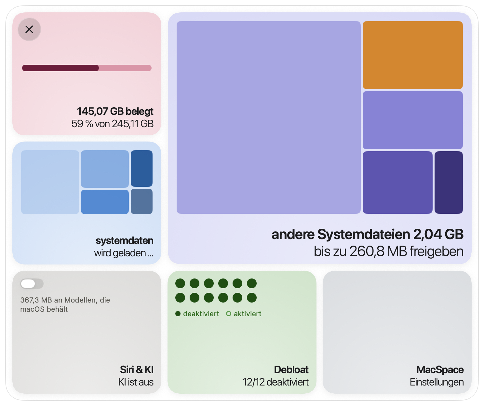
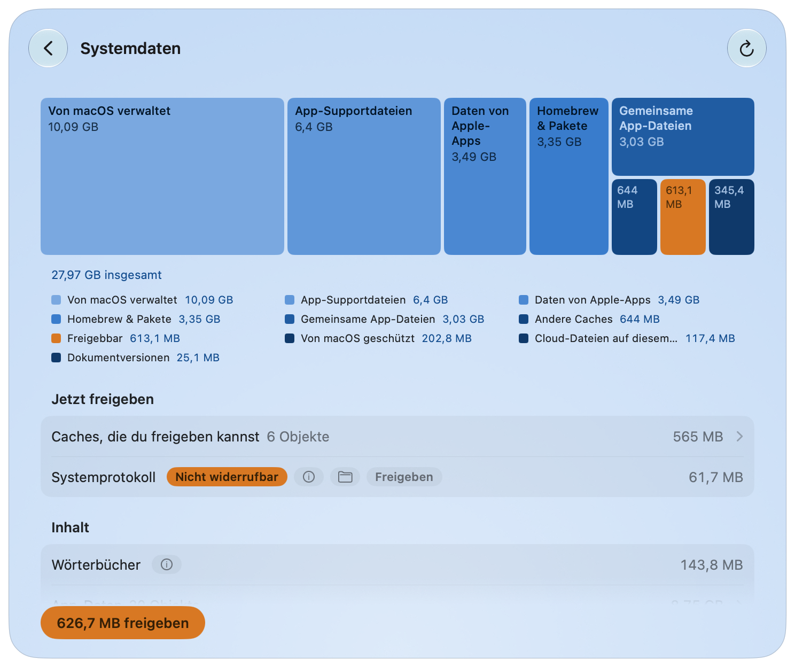
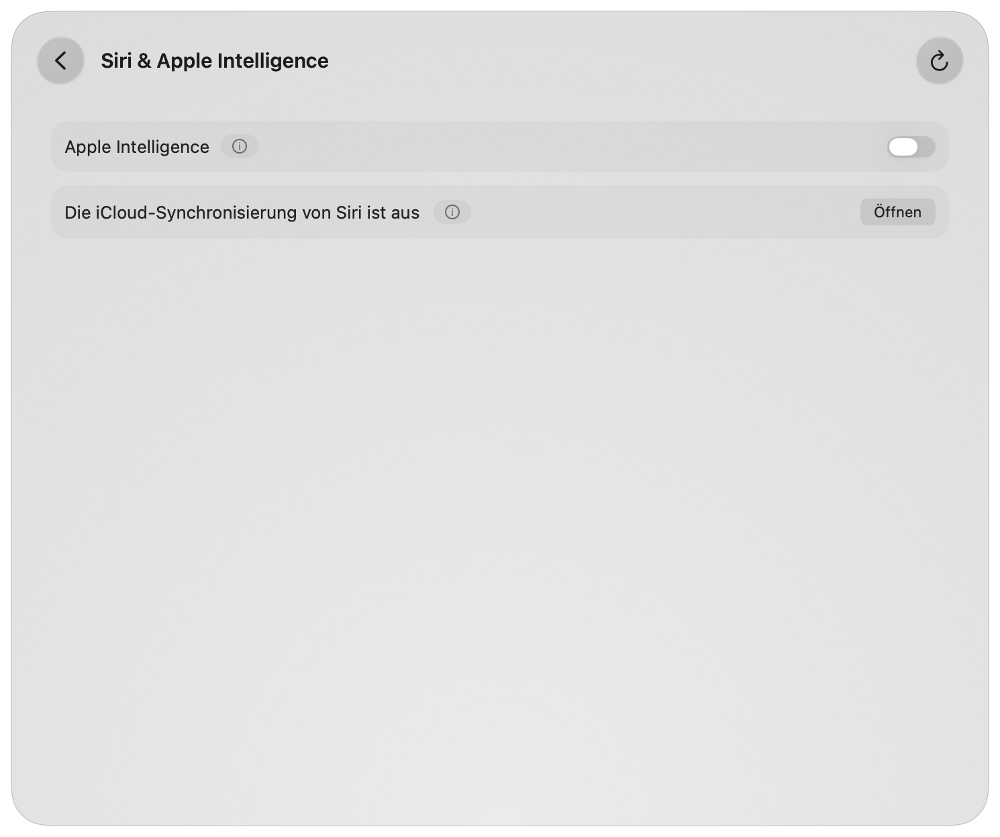
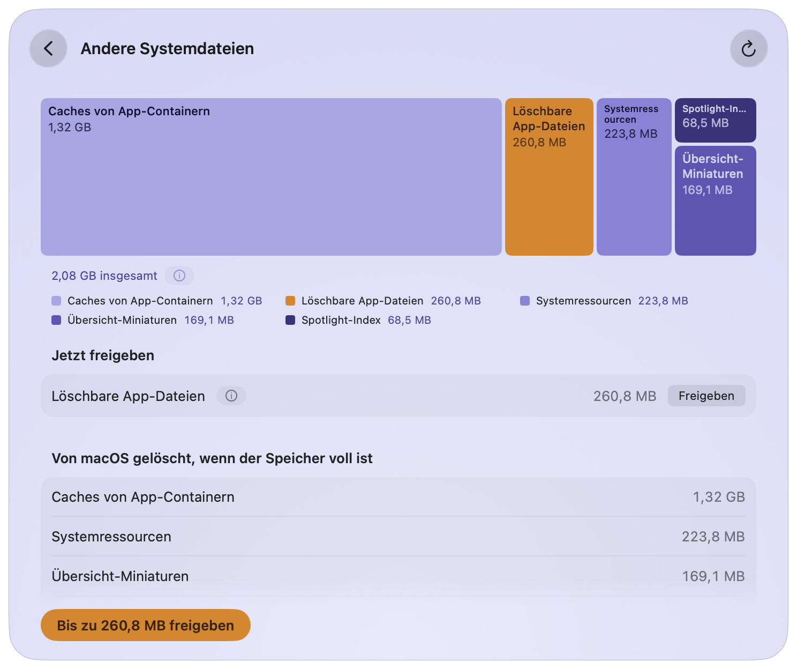
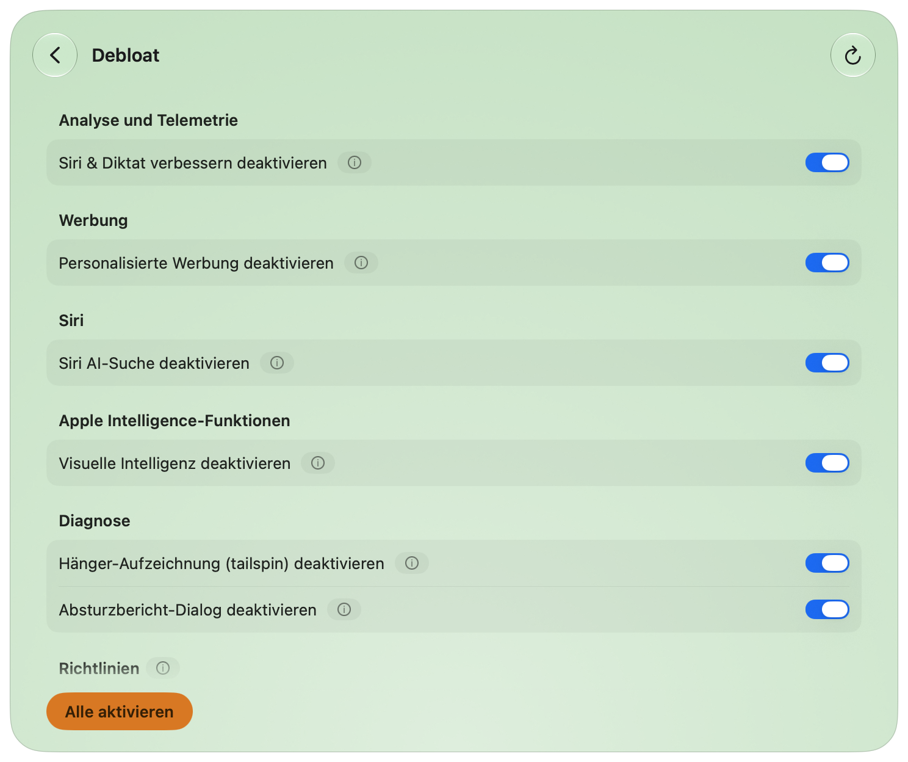
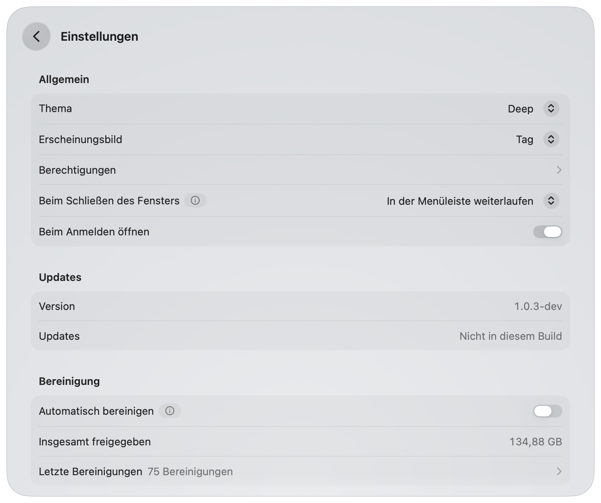
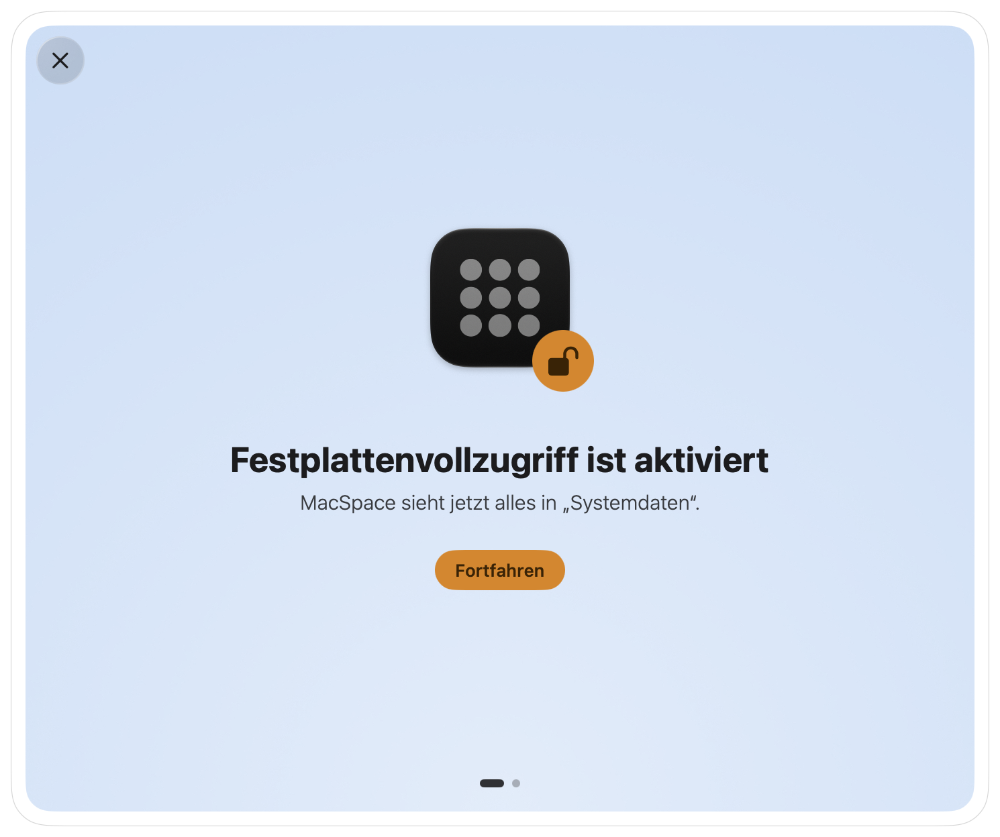

[English](../../../README.md) · [Português](../pt-BR/README.md) · [Español](../es/README.md) · [Français](../fr/README.md) · **Deutsch** · [简体中文](../zh-Hans/README.md) · [日本語](../ja/README.md) · [한국어](../ko/README.md)

# MacSpace

**Eine Bereinigungs-App für „Systemdaten“ und Apple Intelligence unter macOS.**

<p align="left">
<a href="https://trendshift.io/repositories/288700?utm_source=trendshift-badge&amp;utm_medium=badge&amp;utm_campaign=badge-trendshift-288700" target="_blank" rel="noopener noreferrer"></a>
</p>

[](https://github.com/1architect/macspace-releases/actions/workflows/ci.yml)
[](https://github.com/1architect/macspace-releases/releases/latest)
[](../../../LICENSE)


MacSpace zeigt, was „Systemdaten“ füllt, und gibt frei, was sich gefahrlos löschen lässt. Es
schaltet Apple Intelligence aus und löscht danach die Modelle, die macOS auf dem Speicher behält.
Es gibt die Dateien frei, die Apps als löschbar markiert haben, und kann die Analyse und die
Datensammlung im Hintergrund ausschalten, die macOS dich steuern lässt. Es ist kostenlos und Open
Source, und es **sammelt keine Daten über dich**.

[**MacSpace herunterladen**](#installation) ·
[Datenschutzerklärung](PRIVACY.md) ·
[Sicherheit](SECURITY.md) ·
[Änderungsprotokoll](../../../CHANGELOG.md) (auf Englisch)

<p align="center">
  <picture>
    <source media="(prefers-color-scheme: dark)" srcset="Docs/Screenshots/de/Home-Dark.png">
    
  </picture>
</p>

---

## Was MacSpace kann

MacSpace hat vier Module. Du kannst sie in den Einstellungen ein- oder ausschalten.

**Systemdaten.** „Systemdaten“ ist der Teil des Speichers, den die Systemeinstellungen nicht
aufschlüsseln. MacSpace berechnet ihn so wie die Systemeinstellungen (belegter Speicher abzüglich
macOS und jeder anderen Kategorie), sodass der Wert nahe an dem liegt, den du dort siehst. Danach
schlüsselt es ihn auf: Caches, Protokolle, Berichte, Systemressourcen, App-Daten, Versionsverlauf
von Dokumenten.

Die Hauptschaltfläche, **Freigeben**, löscht, was gefahrlos gelöscht werden kann. Objekte, die mehr
Vorsicht verlangen, haben eigene Schaltflächen. Bei allem, was zu macOS oder zu anderen Apps
gehört, sagt MacSpace, was es ist und was du von Hand tun kannst. Auch App-Caches lassen sich
auswählen: **Freigeben** fragt, bevor es eine geöffnete App beendet. Oder wähle in den Einstellungen
der App einen anderen installierten Reiniger, der die App-Caches statt MacSpace übernimmt.

<p align="center">
  
</p>

**Siri & Apple Intelligence.** Ausgeschaltet, stellt MacSpace Siri auf eine andere Sprache als die
deines Macs. So entscheidet macOS, dass Apple Intelligence nicht verfügbar ist. Danach löscht
MacSpace die Modelle, die macOS auf dem Speicher behält; das können etwa 12 GB sein. Schaltest du
es wieder ein, stellt MacSpace deine Siri-Sprache und deine Siri-Stimme wieder her.

Drei weitere Schalter schalten die folgenden Funktionen aus und löschen die Modelle, die auf dem
Speicher bleiben: **Siri, Räumliche Fotos und Anruftranskription**.

<p align="center">
  
</p>

**Andere Systemdateien.** Speicher außerhalb von „Systemdaten“, den macOS als löschbar zählt.
macOS gibt ihn frei, wenn der Speicher fast voll ist. **Bis zu … freigeben** bittet macOS, das
jetzt zu tun. Kopien von Cloud-Dateien auf diesem Mac (OneDrive, iCloud Drive und andere
Cloud-Ordner) haben eine eigene Zeile und eine eigene Schaltfläche, **Downloads entfernen**. Die
Dateien bleiben in der Cloud und werden beim Öffnen erneut geladen. Dieses Modul bereinigt auch
veraltete macOS-Updates und alte Time-Machine-Schnappschüsse.

<p align="center">
  
</p>

**Debloat.** Zwölf Schalter für Analyse, Werbung und Datensammlung im Hintergrund. Ist ein Schalter
an, hat MacSpace diese Funktion ausgeschaltet. Solange MacSpace läuft, prüft es alle 15 Minuten und
schaltet alles erneut aus, was macOS wieder eingeschaltet hat.

| Schalter | Was er bewirkt | Wirksam |
|---|---|---|
| Analysedaten mit Apple teilen | Sendet keine Nutzungs- und Absturzdaten mehr an Apple und App-Entwickler. | Sofort |
| Siri & Diktat verbessern | Teilt keine Aufnahmen von Siri und Diktat mehr mit Apple. | Sofort |
| Diktat und Übersetzung auf Apple-Servern | Diktat und Übersetzung bleiben auf diesem Mac. Sprachen ohne Modell auf dem Gerät funktionieren nicht mehr. | Nach erneutem Öffnen der Apps |
| Personalisierte Werbung | Apple wählt Werbung nicht mehr nach deinen Aktivitäten aus. | Nach erneutem Öffnen der Apps |
| Werbe-ID | Apps können dich nicht über die Werbe-ID tracken oder danach fragen. | Nach erneutem Öffnen der Apps |
| Siri AI-Suche | Beendet die Siri-AI-Suche-App. Spotlight kehrt zur klassischen Suche zurück. Siri selbst findest du auf der Seite „Siri & Apple Intelligence“. | Nach einem Neustart |
| Visuelle Intelligenz | Deaktiviert Visuelle Intelligenz. Visuelles Nachschlagen funktioniert dann eventuell auch nicht mehr. | Nach einem Neustart |
| Internetergebnisse in Spotlight | Spotlight sendet deine Suchen nicht mehr an Apple. Keine Webergebnisse mehr in Spotlight. | Nach erneutem Öffnen der Apps |
| Hänger-Aufzeichnung (tailspin) | Verhindert, dass macOS ständig Aktivität für Hängeberichte aufzeichnet. Gibt etwa 100 MB Arbeitsspeicher frei. | Sofort |
| Absturzbericht-Dialog | Keine Dialoge „unerwartet beendet“ mehr. | Nach einem Neustart |
| Game Center | Deaktiviert Game Center. | Nach dem Abmelden |
| Apple News | Blendet Apple News und seine Widgets aus. | Nach dem Abmelden |

Fünf davon sind Richtlinien. Beim Deaktivieren musst du einmal ein Profil in den
Systemeinstellungen genehmigen (siehe [Berechtigungen](#erster-start-und-berechtigungen)). Unter
einer macOS-Beta ist auch der Schalter für Analysedaten eine Richtlinie.

<p align="center">
  
</p>

**Außerdem in MacSpace.** **Automatisch bereinigen** gibt ohne Rückfrage frei, was die Module
freigeben können, solange MacSpace läuft. **Letzte Bereinigungen** zeigt den Verlauf dessen, was
bereinigt wurde. **Beim Schließen des Fensters** kann sich MacSpace beenden, in der Menüleiste
weiterlaufen (Standard) oder unsichtbar im Hintergrund weiterlaufen. Mit Rechtsklick auf das Symbol
in der Menüleiste kommst du schnell zu jedem Modul.

---

## Installation

### Homebrew

```bash
brew install --cask 1architect/macspace/macspace
```

### Direkter Download (DMG)

Lade die neueste `MacSpace-x.y.z.dmg` von
[Releases](https://github.com/1architect/macspace-releases/releases/latest) herunter, öffne sie
und ziehe **MacSpace** in deinen Ordner „Programme“.

Jede Version hat außerdem eine Datei `MacSpace-x.y.z.dmg.sha256`. Um deinen Download zu prüfen,
lege beide Dateien in einen Ordner und führe aus:

```bash
shasum -a 256 -c MacSpace-x.y.z.dmg.sha256
```

Das gibt `MacSpace-x.y.z.dmg: OK` aus. MacSpace ist mit einer Developer ID signiert und von Apple
notarisiert. Mehr dazu unter [Sicherheit](SECURITY.md).

### Voraussetzungen

macOS 27 oder neuer, auf Apple Silicon.

### Updates und Einstellungen

MacSpace aktualisiert sich mit [Sparkle](https://sparkle-project.org). Wähle **Nach Updates
suchen …** im MacSpace-Menü oder **Jetzt prüfen** unter **Einstellungen > Updates**.
**Automatisch nach Updates suchen**, am selben Ort, lässt MacSpace etwa einmal am Tag suchen,
solange es läuft. Jedes Update ist signiert, und Sparkle prüft die Signatur, bevor es etwas
installiert.

<p align="center">
  
</p>

---

## Erster Start und Berechtigungen

Bei einer Neuinstallation beginnt MacSpace mit dem, was es braucht, Bildschirm für Bildschirm:
**Festplattenvollzugriff erlauben**, **Hilfsprogramm genehmigen**, **Mitteilungen erhalten**,
dann **Alles bereit**. Jeder Schritt kann warten (**Später**), und Schritte, die du schon
erledigt hast, werden übersprungen. Du findest sie wieder unter **Einstellungen >
Berechtigungen**.

<p align="center">
  
</p>

| Berechtigung | Wo du sie erteilst | Wozu MacSpace sie braucht | Module |
|---|---|---|---|
| Festplattenvollzugriff | Systemeinstellungen > Datenschutz & Sicherheit > Festplattenvollzugriff | Um alles auf dem Speicher zu messen und den Zustand von Apple Intelligence zu lesen. | Systemdaten, Siri & Apple Intelligence |
| Privilegiertes Hilfsprogramm | Systemeinstellungen > Allgemein > Anmeldeobjekte & Erweiterungen, unter **Im Hintergrund erlauben** | Ein kleines Programm, das die wenigen Aufgaben erledigt, die einen Administrator erfordern (siehe unten). | Systemdaten, Siri & Apple Intelligence, Debloat |
| Mitteilungen | macOS fragt beim ersten Mal | Um dir zu sagen, wenn etwas fertig ist oder dich braucht. | Alle |
| Konfigurationsprofil | Systemeinstellungen > Allgemein > Geräteverwaltung | Wendet die Debloat-Richtlinien an, die du einschaltest. Nur für die Richtlinien nötig (fünf; sechs unter einer macOS-Beta). | Debloat |

„Andere Systemdateien“ braucht keine eigene Berechtigung. macOS übernimmt jede Autorisierung,
sodass MacSpace dein Passwort nie sieht.

Das Hilfsprogramm ist ein Launch-Daemon, `com.macspace.helper`. Es führt nur benannte Operationen
aus, die fest in ihm eingebaut sind, ein Aufrufer kann ihm keine Befehle schicken, und es akzeptiert
nur Clients, die vom selben Entwicklerteam wie MacSpace signiert sind. Mehr dazu unter
[Sicherheit](SECURITY.md).

---

## Sicherheit

**Objekte, die MacSpace löscht**

- Caches, die Apps neu aufbauen: die Caches im Systemcache-Ordner pro Benutzer
  (`/var/folders/…/C`) und die Web-Caches (`Cache`, `Code Cache`, `GPUCache`), die Chromium- und
  Electron-Apps in `~/Library/Application Support` ablegen. Nur solange die App oder das Werkzeug, dem
  sie gehören, samt Hilfsprozessen geschlossen ist und kein Programm darin eine Datei geöffnet hat.
- Die Kopien, die macOS beim Prüfen einer App anlegt (`/var/folders/…/X`), für den Speicher, den sie
  allein belegen, wenn die App aktualisiert wurde, und nur solange die App geschlossen ist.
- Diagnose- und Absturzberichte, die älter als 7 Tage sind, in `/Library/Logs/DiagnosticReports`
  und `~/Library/Logs/DiagnosticReports`.
- Ungenutzte Systemressourcen, Apple Intelligence-Modelle, die macOS freigegeben hat, und
  Dateien, die Apps als löschbar markiert haben. MacSpace fordert sie beim Bereinigungsdienst von
  macOS an, den macOS selbst ausführt, wenn der Speicher fast voll ist. Sie werden bei Bedarf
  erneut geladen.
- Nur wenn du die zugehörige Schaltfläche drückst: der Versionsverlauf von Dokumenten, die
  übrigen Dateien eines installierten macOS-Updates, die Downloads von Hintergrundbildern und
  Bildschirmschonern, die macOS unvollständig liegen ließ, und die lokalen Kopien von
  Cloud-Dateien. Bei den Downloads löscht das Hilfsprogramm nur die Dateien
  `CFNetworkDownload_*.tmp` in `/var/folders/…/T/com.apple.idleassetsd`, die sich seit 3 Tagen
  nicht geändert haben; ein laufender Download bleibt.
- Nur wenn du die zugehörige Schaltfläche drückst: das Systemprotokoll, mit Apples eigenem
  `log erase`; die Symbole, die macOS zum Lesen von Absturzberichten aufbewahrt und neu aufbaut;
  alles im Papierkorb; die lokalen Schnappschüsse von Time Machine außer dem neuesten
  und dem, von dem das nächste Backup ausgeht; und die Backups, die du auf einem angeschlossenen
  Backup-Volume auswählst, nie das neueste. Schnappschüsse und Backups werden nie gelöscht, während
  ein Backup läuft.
- Nur die Caches, die du unter **App-Caches** auswählst: Ordner in `~/Library/Caches` und, mit
  Festplattenvollzugriff, der Inhalt des Cache-Ordners im Container jeder App
  (`~/Library/Containers/<App>/Data/Library/Caches`), außer dem, was macOS dort ablegt. Nie die von
  Apple. Vorausgewählt sind die, die seit einem Monat unverändert sind und deren App so lange nicht
  geöffnet wurde oder nicht installiert ist. Genutzte Caches stehen ohne Häkchen da und sagen, dass
  sie zurückkommen. Die Caches einer geöffneten App lassen sich ebenfalls ankreuzen: **Freigeben**
  nennt die App, bittet sie, sich zu beenden (sie kann dich ums Sichern bitten, und du kannst
  abbrechen), und gibt dann ihren Cache frei. Das automatische Aufräumen beendet nie eine App.
  Ordner mit Medien oder Dokumenten, die Menschen benannt haben, werden nicht angeboten.
- Nur über die Zeile **Homebrew**: das eigene `brew cleanup` von Homebrew, als du ausgeführt, ohne
  Formeln zu deinstallieren, zu aktualisieren oder Homebrews Statistiken zu senden.

**Unangetastete Objekte.** MacSpace misst nur, wie viel Platz deine Dokumente, Fotos, Mail und
Nachrichten belegen. Es listet große Objekte wie unvollständige Downloads, macOS-Wiederherstellungs-
images und virtuelle Maschinen auf. Daten anderer Apps lässt es in Ruhe und sagt, wie du sie
innerhalb der App bereinigst. **Es liest oder löscht deine persönlichen Dateien nicht. Es schaltet
den Systemintegritätsschutz nicht aus und verändert das versiegelte Systemvolume nicht.**

**Berechtigungen während der Nutzung.** Jede Schaltfläche, die die Caches von mehr als einer App
löscht, fragt nach. **Freigeben** beim Versionsverlauf von Dokumenten, beim Systemprotokoll, beim
Papierkorb und bei den Schnappschüssen und Backups von Time Machine trägt das Etikett **Nicht
widerrufbar**. Der Schalter **Apple Intelligence** und die einzelnen Debloat-Schalter wirken
sofort und gehen von selbst zurück, wenn die Änderung scheitert.

**Umkehrbare Aktionen.** Debloat: Schalte die Funktion wieder ein oder drücke **Alle aktivieren**.
MacSpace stellt die Einstellungen wieder her, die es vor der Änderung gesichert hat. Apple
Intelligence und Siri-bezogene Optionen: Schalte sie wieder ein. MacSpace stellt deine
Siri-Sprache und deine Siri-Stimme wieder her, und macOS lädt die Modelle eventuell erneut. Gelöschte
Caches werden neu aufgebaut. Gelöschte Berichte, Versionsverläufe, Protokolle, Objekte im Papierkorb,
Schnappschüsse und Backups kommen nicht zurück.

---

## Datenschutz

MacSpace hat keine Analyse, keine Telemetrie, keine Absturzberichte und keinen Account. Was es
misst, dein Bereinigungsverlauf und deine Einstellungen bleiben auf deinem Mac, unter
`~/Library/Application Support/MacSpace/`. Das Netzwerk wird für eine einzige Sache genutzt:
Updates. MacSpace liest einen kleinen Update-Feed auf GitHub und lädt, wenn du ein Update
annimmst, es von GitHub herunter. Es sendet kein Systemprofil und keine Kennung. Jede Datei, die
es schreibt, und alles, was es liest, steht in der [Datenschutzerklärung](PRIVACY.md) und in
der [Sicherheitsrichtlinie](SECURITY.md).

---

## Deinstallation

Zum **Deinstallieren** nutze das Deinstallationsprogramm von MacSpace. Klicke in der Menüleiste auf
**MacSpace**, dann auf **Über MacSpace** und anschließend auf **Deinstallieren**. Das
Deinstallationsprogramm automatisiert den folgenden Ablauf.

Wenn du es lieber von Hand machst, halte diese Reihenfolge ein:

1. **Mache rückgängig, was MacSpace geändert hat.** Drücke in **Debloat** auf **Alle aktivieren**.
   Das entfernt auch die Überschreibungen, die Debloat außerhalb der eigenen Ordner von MacSpace
   geschrieben hat und die bestehen bleiben, wenn du nur die App löschst. Ist ein Neustart nötig,
   sagt es die Seite. Wenn du Apple Intelligence, Siri, Räumliche Fotos oder Anruftranskription
   ausgeschaltet hast und sie zurückhaben willst, schalte sie in **Siri & Apple Intelligence** ein.
2. **Entferne das Profil**, falls noch eines installiert ist: Wähle in den Systemeinstellungen >
   Allgemein > Geräteverwaltung **MacSpace: policies** (Kennung `com.macspace.policies`) und
   entferne es.
3. **Beende MacSpace** (**MacSpace beenden** im MacSpace-Menü oder im Menü seines Symbols in der
   Menüleiste). Entferne das Hilfsprogramm: Schalte MacSpace unter Systemeinstellungen > Allgemein >
   Anmeldeobjekte & Erweiterungen aus oder führe dies aus, bevor du die App löschst:
   ```bash
   /Applications/MacSpace.app/Contents/MacOS/MacSpaceCli helper --unregister
   ```
4. **Entferne die App:** `brew uninstall --cask macspace` (mit `--zap` werden auch ihre Daten und
   Einstellungen entfernt) oder ziehe **MacSpace** aus „Programme“ in den Papierkorb.
5. **Entferne ihre Daten und Einstellungen:**
   ```bash
   rm -rf ~/Library/Application\ Support/MacSpace ~/Library/Logs/MacSpace ~/Library/Caches/com.macspace.app
   defaults delete com.macspace.app
   sudo rm -rf /Library/Application\ Support/MacSpace
   ```
   Die letzte Zeile ist nur nötig, wenn du Debloat oder Anruftranskription genutzt oder übrig
   gebliebene Apple-Intelligence-Abonnements entfernt hast. Führe sie nach Schritt 1 aus: Dieser
   Ordner enthält die Originale, die MacSpace wiederherstellt.
6. **Entferne den Festplattenvollzugriff:** Wähle in den Systemeinstellungen > Datenschutz &
   Sicherheit > Festplattenvollzugriff MacSpace aus und drücke die Minus-Taste.

Wie sich macOS verhält, mit Messwerten, steht in [Docs/Research.md](../../../Docs/Research.md) (auf
Englisch).

---

## Aus dem Quellcode bauen

Der Quellcode ist dieses Repository. [Docs/Handoff.md](../../../Docs/Handoff.md) (auf Englisch) erklärt,
wie es aufgebaut ist. Du brauchst macOS 27 und Xcode 27.

```bash
export DEVELOPER_DIR=/Applications/Xcode-beta.app/Contents/Developer
swift test
INSTALL=1 Scripts/Assemble.sh
```

Der letzte Befehl baut `Build/MacSpace.app` und kopiert es nach `/Applications`. Ohne ein
Developer-ID-Zertifikat wird der Build ad hoc signiert und nicht notarisiert, und macOS fragt
nach jedem Build erneut nach Festplattenvollzugriff. Ein Build, den du selbst erstellst, hat
keinen Update-Schlüssel und sucht daher nie nach Updates.

---

## Support und Mitwirken

**dev@giomantovani.com.br**

Fehler, Ideen und falsche Übersetzungen: [GitHub Issues](https://github.com/1architect/macspace-releases/issues).
Sicherheitsprobleme: niemals in einem öffentlichen Issue, siehe [SECURITY.md](SECURITY.md).
Wenn du mitwirken möchtest, lies [CONTRIBUTING.md](../../../CONTRIBUTING.md) (auf Englisch). Alle, die
mitmachen, befolgen den [Verhaltenskodex](../../../CODE_OF_CONDUCT.md) (auf Englisch). Änderungen stehen
im [Änderungsprotokoll](../../../CHANGELOG.md).

---

## Lizenz

MacSpace ist freie Software unter der MIT-Lizenz. Copyright (c) 2026 1architect. Siehe
[LICENSE](../../../LICENSE) (auf Englisch). Verbindlich ist der englische Text. Die Übersetzungen in
`Docs/Translations/<language>/LICENSE.md` dienen nur der Orientierung. Hinweise zu Drittsoftware stehen in
[NOTICE](../../../NOTICE) (auf Englisch).

MacSpace steht in keiner Verbindung zu Apple. Apple Intelligence, Siri und macOS sind Marken der
Apple Inc.
