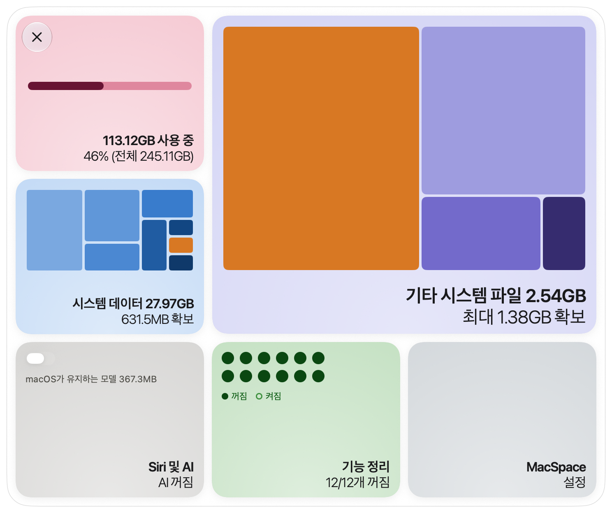
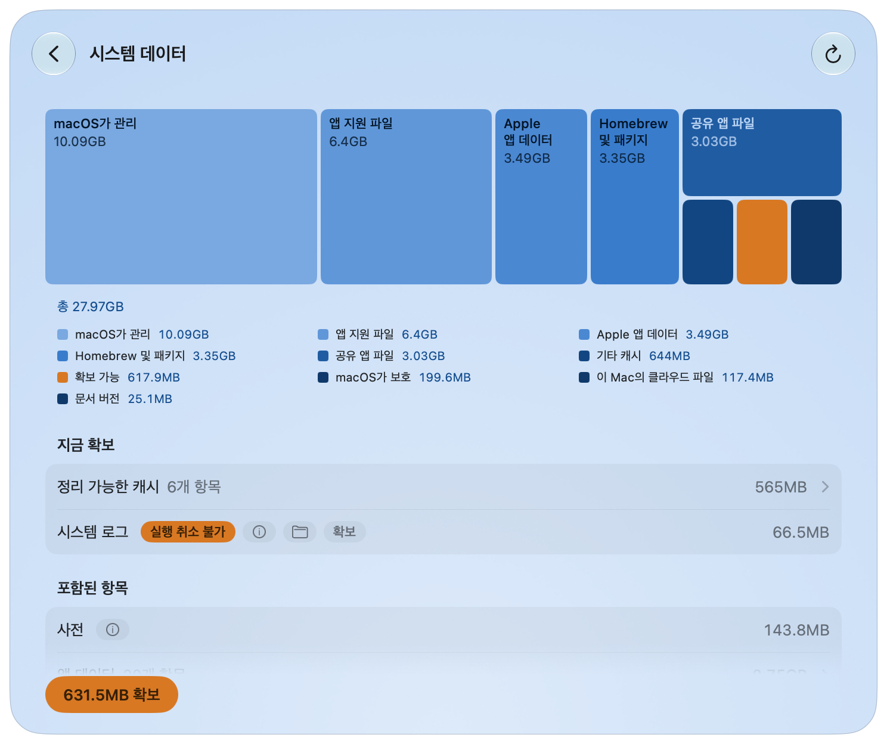
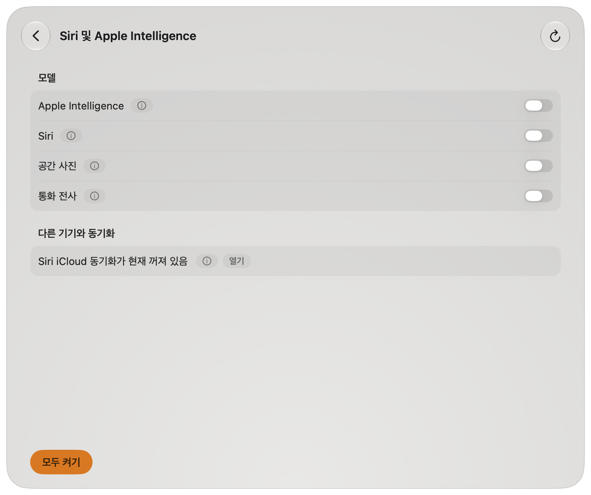
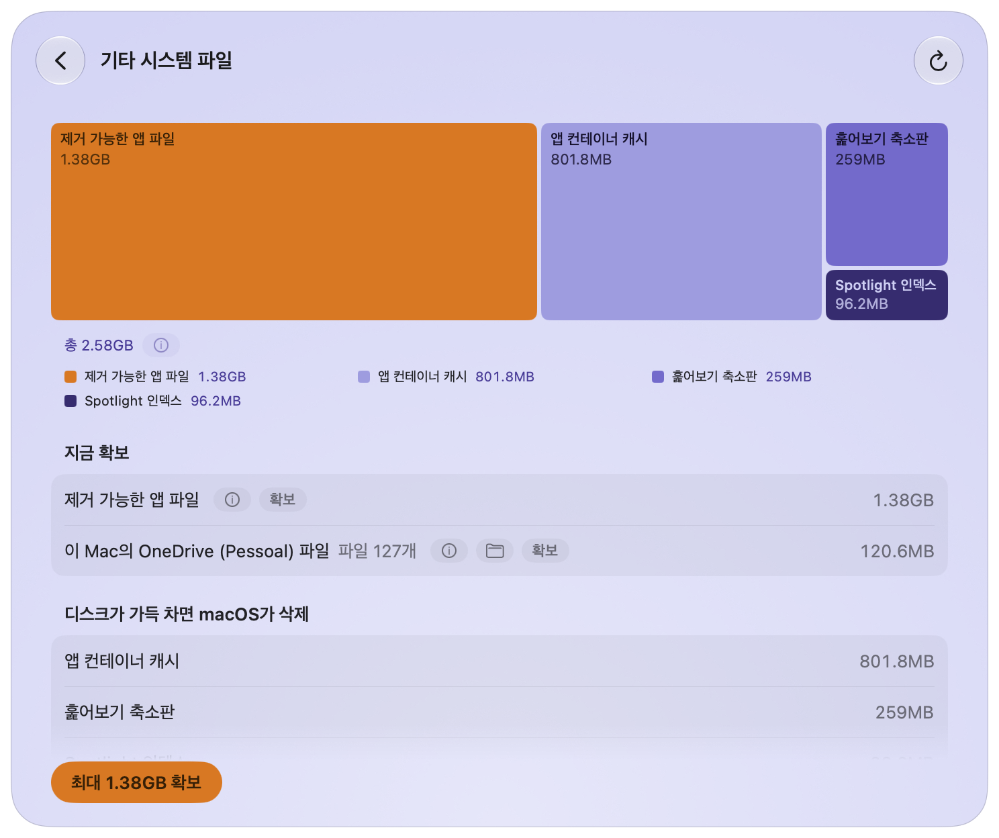
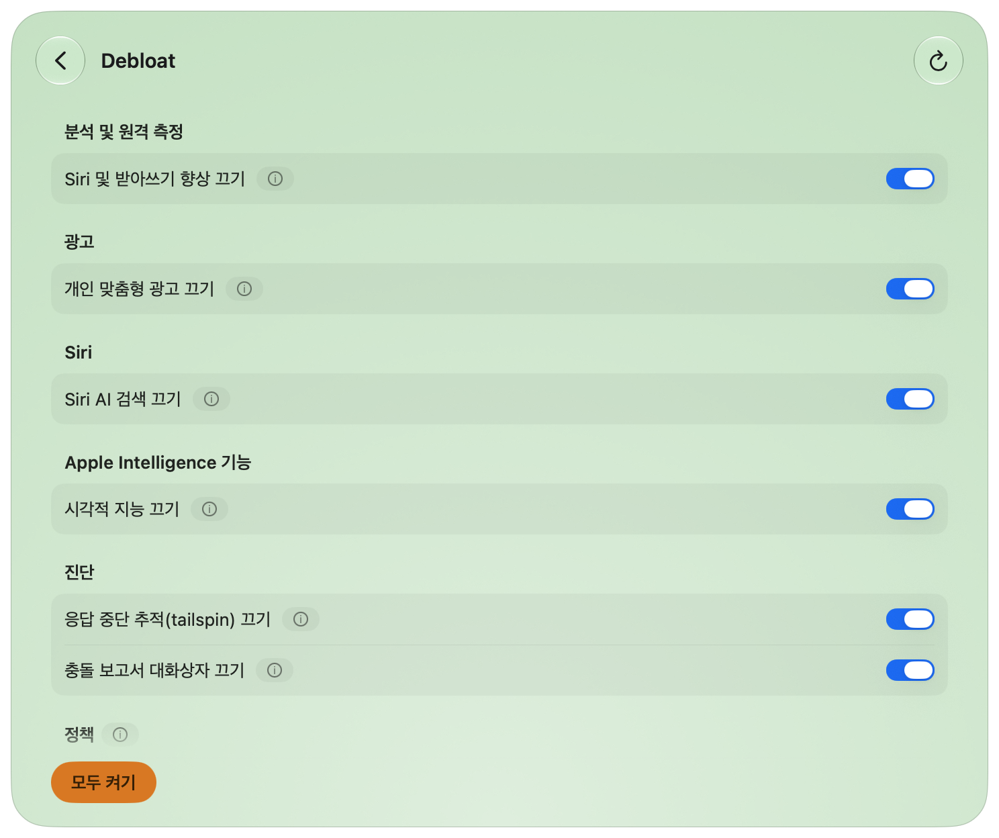
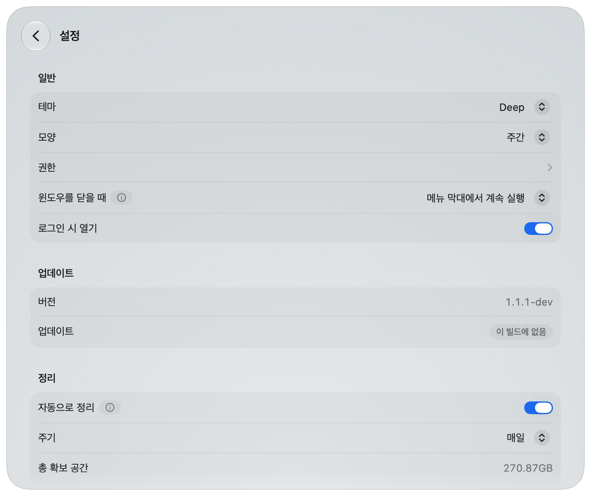
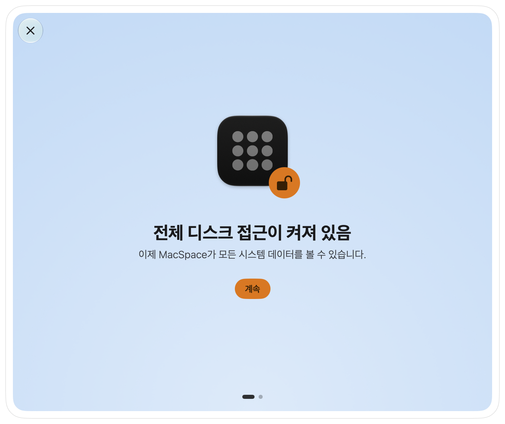

[English](../../../README.md) · [Português](../pt-BR/README.md) · [Español](../es/README.md) · [Français](../fr/README.md) · [Deutsch](../de/README.md) · [简体中文](../zh-Hans/README.md) · [日本語](../ja/README.md) · **한국어**

# MacSpace

**macOS용 시스템 데이터 및 Apple Intelligence 정리 도구.**

<p align="left">
<a href="https://trendshift.io/repositories/288700?utm_source=trendshift-badge&amp;utm_medium=badge&amp;utm_campaign=badge-trendshift-288700" target="_blank" rel="noopener noreferrer"></a>
</p>

[](https://github.com/1architect/macspace-releases/actions/workflows/ci.yml)
[](https://github.com/1architect/macspace-releases/releases/latest)
[](../../../LICENSE)


MacSpace는 시스템 데이터를 무엇이 채우고 있는지 보여 주고, 안전하게 삭제할 수 있는 것을 확보합니다.
Apple Intelligence를 끄고, 그 뒤에도 macOS가 디스크에 남겨 두는 모델을 삭제합니다. 앱이 지울 수
있는 파일로 표시한 항목을 확보하며, macOS에서 제어할 수 있는 분석과 백그라운드 데이터 수집도 끌 수
있습니다. 무료 오픈 소스이며, **사용자에 대한 데이터를 전혀 수집하지 않습니다**.

[**MacSpace 다운로드**](#설치) ·
[개인정보 처리방침](PRIVACY.md) ·
[보안](SECURITY.md) ·
[변경 내역](../../../CHANGELOG.md)(영어)

<p align="center">
  <picture>
    <source media="(prefers-color-scheme: dark)" srcset="Docs/Screenshots/ko/Home-Dark.png">
    
  </picture>
</p>

---

## 기능

MacSpace에는 네 개의 모듈이 있습니다. 설정에서 켜거나 끌 수 있습니다.

**시스템 데이터.** 시스템 데이터는 시스템 설정이 설명하지 않는 디스크 부분입니다. MacSpace는 시스템
설정과 같은 방식(사용한 공간에서 macOS와 다른 모든 카테고리를 뺀 값)으로 계산하므로, 그곳에서 보는
값과 비슷합니다. 그런 다음 캐시, 로그, 보고서, 시스템 에셋, 앱 데이터, 문서 버전 기록으로 나누어
보여 줍니다.

주 버튼인 **확보**는 안전한 항목을 삭제합니다. 더 주의가 필요한 항목에는 각각 전용 버튼이 있습니다.
macOS나 다른 앱에 속한 항목은 MacSpace가 그것이 무엇인지, 직접 무엇을 해야 하는지 알려 줍니다. 앱
캐시도 선택할 수 있습니다. **확보**는 열려 있는 앱을 종료하기 전에 먼저 물어봅니다. 또는 앱 설정에서
MacSpace 대신 앱 캐시를 처리할 다른 설치된 정리 도구를 선택할 수 있습니다.

<p align="center">
  
</p>

**Siri 및 Apple Intelligence.** 끄면 MacSpace가 Siri를 Mac과 다른 언어로 설정합니다. macOS는 이렇게
Apple Intelligence를 사용할 수 없다고 판단합니다. 그런 다음 MacSpace는 macOS가 디스크에 보관하는
모델(약 12GB에 이를 수 있음)을 삭제합니다. 다시 켜면 MacSpace가 Siri 언어와 음성을 되돌려 놓습니다.

스위치 세 개가 더 있어, 다음 기능을 끄고 디스크에 남은 모델을 삭제합니다:
**Siri, 공간 사진, 통화 전사**.

<p align="center">
  
</p>

**기타 시스템 파일.** 시스템 데이터 밖에 있으면서 macOS가 지울 수 있는 공간으로 계산하는 항목입니다.
디스크가 거의 가득 차면 macOS가 알아서 확보합니다. **최대 … 확보**는 macOS가 지금 정리하도록
합니다. 이 Mac에 보관된 클라우드 파일의 복사본(OneDrive, iCloud Drive 및 기타 클라우드 폴더)에는
전용 행과 **다운로드 제거** 버튼이 있습니다. 파일은 클라우드에 그대로 남고, 열면 다시 다운로드됩니다.
이 모듈은 오래된 macOS 업데이트와 오래된 Time Machine 스냅샷도 정리합니다.

<p align="center">
  
</p>

**Debloat.** 분석, 광고, 백그라운드 데이터 수집을 위한 열두 개의 스위치입니다. 스위치가 켜져 있으면
MacSpace가 해당 기능을 껐다는 뜻입니다. MacSpace가 실행되는 동안 15분마다 확인하여, macOS가 다시 켠
항목을 다시 끕니다.

| 스위치 | 하는 일 | 적용 시점 |
|---|---|---|
| Apple과 분석 공유 | Apple과 앱 개발자에게 사용 및 충돌 데이터를 보내지 않습니다. | 즉시 |
| Siri 및 받아쓰기 향상 | Siri와 받아쓰기 녹음을 Apple과 공유하지 않습니다. | 즉시 |
| Apple 서버에서 받아쓰기 및 번역 | 받아쓰기와 번역이 이 Mac에서만 처리됩니다. 기기 내 모델이 없는 언어는 작동하지 않게 됩니다. | 앱을 다시 연 후 |
| 개인 맞춤형 광고 | Apple이 사용자의 활동을 기반으로 광고를 고르지 않습니다. | 앱을 다시 연 후 |
| 광고 식별자 | 앱이 광고 식별자로 사용자를 추적하거나 요청할 수 없습니다. | 앱을 다시 연 후 |
| Siri AI 검색 | Siri AI 검색 앱을 중지합니다. Spotlight가 기본 검색으로 돌아갑니다. Siri 자체는 Siri 및 Apple Intelligence 페이지에 있습니다. | 재시동 후 |
| 시각적 지능 | 시각적 지능을 끕니다. 시각 자료 찾기도 작동하지 않을 수 있습니다. | 재시동 후 |
| Spotlight 인터넷 결과 | Spotlight가 검색어를 Apple에 보내지 않습니다. Spotlight에 웹 결과가 더 이상 표시되지 않습니다. | 앱을 다시 연 후 |
| 응답 중단 추적(tailspin) | macOS가 응답 중단 보고서를 위해 활동을 계속 기록하는 것을 막습니다. 메모리 약 100MB를 확보합니다. | 즉시 |
| 충돌 보고서 대화상자 | '예기치 않게 종료됨' 대화상자가 더 이상 나타나지 않습니다. | 재시동 후 |
| Game Center | Game Center를 끕니다. | 로그아웃 후 |
| Apple News | Apple News와 해당 위젯을 숨깁니다. | 로그아웃 후 |

이 중 다섯 개는 정책입니다. 정책을 끄려면 시스템 설정에서 프로파일을 한 번 승인해야 합니다
([권한](#처음-실행과-권한) 참조). macOS 베타에서는 분석 스위치도 정책입니다.

<p align="center">
  
</p>

**MacSpace의 기타 기능.** **자동으로 정리**는 MacSpace가 실행되는 동안 각 모듈이 묻지 않고 확보할 수
있는 항목을 확보합니다. **최근 정리**는 정리한 내용의 기록을 보여 줍니다. **윈도우를 닫을 때** MacSpace는
종료하거나, 메뉴 막대에 계속 머물거나(기본값), 보이지 않게 백그라운드에서 계속 실행될 수 있습니다.
메뉴 막대 아이콘을 오른쪽 클릭하면 각 모듈에 쉽게 접근할 수 있습니다.

---

## 설치

### Homebrew

```bash
brew install --cask 1architect/macspace/macspace
```

### 직접 다운로드(DMG)

[Releases](https://github.com/1architect/macspace-releases/releases/latest)에서 최신
`MacSpace-x.y.z.dmg`를 다운로드해 열고, **MacSpace**를 응용 프로그램 폴더로 드래그하세요.

각 릴리스에는 `MacSpace-x.y.z.dmg.sha256`도 있습니다. 다운로드한 파일을 확인하려면 두 파일을 같은
폴더에 넣고 다음을 실행하세요:

```bash
shasum -a 256 -c MacSpace-x.y.z.dmg.sha256
```

`MacSpace-x.y.z.dmg: OK`가 출력됩니다. MacSpace는 Developer ID로 서명되고 Apple의 공증을 받았습니다.
자세한 내용은 [보안](SECURITY.md)을 참조하세요.

### 요구 사항

macOS 27 이상, Apple 실리콘.

### 업데이트 및 설정

MacSpace는 [Sparkle](https://sparkle-project.org)로 업데이트합니다. MacSpace 메뉴에서 **업데이트 확인…**을
선택하거나 **설정 > 업데이트**에서 **지금 확인**을 선택하세요. 같은 곳의 **자동으로 업데이트 확인**을
켜면 MacSpace가 실행되는 동안 하루에 한 번 정도 확인합니다. 모든 업데이트는 서명되어 있으며, Sparkle은
설치 전에 서명을 확인합니다.

<p align="center">
  
</p>

---

## 처음 실행과 권한

새로 설치하면 MacSpace는 필요한 것부터 한 번에 한 화면씩 안내합니다: **전체 디스크 접근 허용**,
**보조 프로그램 승인**, **알림 받기**, 그리고 **준비 완료**. 각 단계는 나중으로 미룰 수 있고(**나중에**),
이미 마친 단계는 건너뜁니다. **설정 > 권한**에서 언제든 다시 할 수 있습니다.

<p align="center">
  
</p>

| 권한 | 허용하는 위치 | MacSpace에 필요한 이유 | 모듈 |
|---|---|---|---|
| 전체 디스크 접근 | 시스템 설정 > 개인정보 보호 및 보안 > 전체 디스크 접근 권한 | 디스크의 모든 항목을 측정하고 Apple Intelligence의 상태를 읽기 위해. | 시스템 데이터, Siri 및 Apple Intelligence |
| 권한이 있는 보조 프로그램 | 시스템 설정 > 일반 > 로그인 항목 및 확장 프로그램의 **백그라운드에서 허용** 아래 | 관리자 권한이 필요한 몇 가지 작업을 하는 작은 프로그램(아래 참조). | 시스템 데이터, Siri 및 Apple Intelligence, Debloat |
| 알림 | 처음에 macOS가 물어봅니다 | 작업이 끝났거나 사용자의 확인이 필요할 때 알려 주기 위해. | 전체 |
| 구성 프로파일 | 시스템 설정 > 일반 > 기기 관리 | 사용자가 켠 Debloat 정책을 적용합니다. 정책에만 필요합니다(다섯 개, macOS 베타에서는 여섯 개). | Debloat |

기타 시스템 파일에는 자체 권한이 필요 없습니다. 모든 인증은 macOS가 처리하므로 MacSpace는 사용자의
암호를 절대 볼 수 없습니다.

보조 프로그램은 실행 데몬(launch daemon)인 `com.macspace.helper`입니다. 내장된 이름 있는 작업만
실행하고, 호출하는 쪽이 명령을 보낼 수 없으며, MacSpace와 같은 개발 팀이 서명한 클라이언트만
받아들입니다. 자세한 내용은 [보안](SECURITY.md)을 참조하세요.

---

## 안전성

**MacSpace가 삭제하는 항목**

- 앱이 다시 만드는 캐시: 사용자별 시스템 캐시 폴더(`/var/folders/…/C`)의 캐시와 Chromium 및 Electron
  앱이 `~/Library/Application Support`에 보관하는 웹 캐시(`Cache`, `Code Cache`, `GPUCache`). 이를 소유한
  앱이나 도구가 보조 프로세스까지 포함해 닫혀 있고, 어떤 프로그램도 그 안의 파일을 열고 있지 않을
  때만 삭제합니다.
- macOS가 앱을 확인할 때 만드는 복사본(`/var/folders/…/X`). 앱이 업데이트된 후 복사본이 단독으로
  차지하는 공간에 한하며, 앱이 닫혀 있을 때만 삭제합니다.
- `/Library/Logs/DiagnosticReports`와 `~/Library/Logs/DiagnosticReports`에 있는 7일 넘은 진단 및 충돌
  보고서.
- 미사용 시스템 에셋, macOS가 해제한 Apple Intelligence 모델, 앱이 지울 수 있는 파일로 표시한 항목.
  MacSpace는 디스크가 거의 가득 찼을 때 macOS가 실행하는 것과 같은, macOS 자체의 정리 서비스에
  요청합니다. 필요하면 다시 다운로드됩니다.
- 전용 버튼을 누를 때만: 문서 버전 기록, 이미 설치된 macOS 업데이트의 남은 파일, macOS가 끝내지 못한
  배경화면 및 화면 보호기 다운로드, 클라우드 파일의 로컬 복사본. 다운로드의 경우 보조 프로그램은
  `/var/folders/…/T/com.apple.idleassetsd`에서 3일 동안 변경되지 않은 `CFNetworkDownload_*.tmp` 파일만
  삭제하므로, 진행 중인 다운로드는 그대로 남습니다.
- 전용 버튼을 누를 때만: Apple 자체의 `log erase`로 지우는 시스템 로그, macOS가 충돌 보고서를 읽기 위해
  보관하는 심벌(다시 만들어짐), 휴지통의 모든 항목, Time Machine의 로컬 스냅샷(가장 최근 것과 다음
  백업의 기준이 되는 것은 제외), 연결된 백업 디스크에서 선택한 백업(최신 백업은 남김). 백업이 실행
  중일 때는 스냅샷과 백업을 삭제하지 않습니다.
- **앱 캐시**에서 선택한 캐시만: `~/Library/Caches`의 폴더와, 전체 디스크 접근이 있을 때 각 앱 컨테이너의
  캐시 폴더 내용(`~/Library/Containers/<app>/Data/Library/Caches`). 다만 macOS가 그곳에 보관하는 항목은
  제외합니다. Apple의 캐시는 절대 포함하지 않습니다. 미리 선택된 항목은 한 달 동안 변경되지 않았고,
  해당 앱도 그만큼 오래 열리지 않았거나 설치되어 있지 않습니다. 사용 중인 캐시는 선택되지 않은 채
  표시되며 다시 생긴다고 안내합니다. 열려 있는 앱의 캐시도 선택할 수 있습니다. **확보**는 앱 이름을
  알려 주고, 종료를 요청한 다음(앱이 저장을 요청할 수 있으며 취소할 수 있음) 그 캐시를 확보합니다.
  자동 정리는 앱을 절대 종료하지 않습니다. 미디어나 사용자가 이름 붙인 문서가 들어 있는 폴더는
  표시되지 않습니다.
- **Homebrew** 행에서만: Homebrew 자체의 `brew cleanup`을 사용자 권한으로 실행하며, formula를
  제거하거나 업데이트하거나 Homebrew의 분석 정보를 보내지 않습니다.

**건드리지 않는 항목.** MacSpace는 문서, 사진, 메일, 메시지가 차지하는 공간을 측정만 합니다. 완료되지
않은 다운로드, macOS 복원 이미지, 가상 머신 같은 큰 항목을 나열합니다. 다른 앱의 데이터는 그대로
두고, 해당 앱 안에서 정리하는 방법을 안내합니다. **개인 파일을 읽거나 삭제하지 않습니다. 시스템 무결성
보호를 끄지 않으며, 봉인된 시스템 볼륨을 변경하지 않습니다.**

**사용 중의 권한.** 둘 이상의 앱 캐시를 삭제하는 모든 버튼은 확인을 요청합니다. 문서 버전 기록, 시스템
로그, 휴지통, Time Machine 스냅샷과 백업의 **확보**에는 **실행 취소 불가** 배지가 붙습니다.
**Apple Intelligence** 스위치와 개별 Debloat 스위치는 즉시 적용되며, 변경에 실패하면 저절로 되돌아갑니다.

**되돌릴 수 있는 작업.** Debloat: 기능을 다시 켜거나 **모두 켜기**를 누르세요. MacSpace는 변경 전에
저장해 둔 설정을 복원합니다. Apple Intelligence와 Siri 관련 옵션: 다시 켜세요. MacSpace는 Siri 언어와
음성을 복원하며, macOS가 모델을 다시 다운로드할 수 있습니다. 삭제한 캐시는 다시 만들어집니다. 삭제한
보고서, 버전 기록, 로그, 휴지통 항목, 스냅샷, 백업은 되돌릴 수 없습니다.

macOS의 동작과 측정 결과는 [Docs/Research.md](../../../Docs/Research.md)(영어)에 있습니다.

---

## 개인정보 보호

MacSpace에는 분석도, 원격 측정도, 충돌 보고도, 계정도 없습니다. 측정한 내용, 정리 기록, 설정은 Mac의
`~/Library/Application Support/MacSpace/`에 보관됩니다. 네트워크는 업데이트라는 한 가지 목적에만
사용합니다. MacSpace는 GitHub의 작은 업데이트 피드를 읽고, 업데이트를 수락하면 GitHub에서
다운로드합니다. 시스템 프로파일이나 식별자는 보내지 않습니다. MacSpace가 쓰는 모든 파일과 읽는 모든
내용은 [개인정보 처리방침](PRIVACY.md)과 [보안 정책](SECURITY.md)에 있습니다.

---

## 제거

**제거**하려면 MacSpace 제거 프로그램을 사용하세요. 메뉴 막대에서 **MacSpace**를 누르고 **MacSpace
정보**를 선택한 다음 **제거**를 클릭하세요. 제거 프로그램이 아래 과정을 자동으로 처리합니다.

직접 하려면 아래 순서를 따르세요:

1. **MacSpace가 바꾼 것을 되돌립니다.** **Debloat**에서 **모두 켜기**를 누릅니다. 이렇게 하면 Debloat이
   MacSpace 자체 폴더 밖에 써 둔 재정의도 제거됩니다. 앱만 삭제하면 이 재정의는 그대로 남습니다. 재시동이
   필요하면 페이지에 안내가 표시됩니다. Apple Intelligence, Siri, 공간 사진, 통화 전사를 껐고 다시
   사용하려면 **Siri 및 Apple Intelligence**에서 켜세요.
2. **프로파일을 제거합니다.** 아직 설치되어 있다면: 시스템 설정 > 일반 > 기기 관리에서
   **MacSpace: policies**(식별자 `com.macspace.policies`)를 선택하고 제거하세요.
3. **MacSpace를 종료합니다**(MacSpace 메뉴의 **MacSpace 종료** 또는 메뉴 막대 아이콘의 메뉴). 보조
   프로그램을 제거합니다: 시스템 설정 > 일반 > 로그인 항목 및 확장 프로그램에서 MacSpace를 끄거나,
   앱을 삭제하기 전에 다음을 실행하세요:
   ```bash
   /Applications/MacSpace.app/Contents/MacOS/MacSpaceCli helper --unregister
   ```
4. **앱을 제거합니다:** `brew uninstall --cask macspace`(`--zap`을 붙이면 데이터와 환경설정도 제거됨)
   또는 응용 프로그램에서 **MacSpace**를 휴지통으로 드래그하세요.
5. **데이터와 환경설정을 제거합니다:**
   ```bash
   rm -rf ~/Library/Application\ Support/MacSpace ~/Library/Logs/MacSpace ~/Library/Caches/com.macspace.app
   defaults delete com.macspace.app
   sudo rm -rf /Library/Application\ Support/MacSpace
   ```
   마지막 줄은 Debloat이나 통화 전사를 사용했거나, 남아 있던 Apple Intelligence 구독을 제거한 경우에만
   필요합니다. 1단계 뒤에 실행하세요. 이 폴더에는 MacSpace가 복원하는 원본이 들어 있습니다.
6. **전체 디스크 접근을 제거합니다:** 시스템 설정 > 개인정보 보호 및 보안 > 전체 디스크 접근 권한에서
   MacSpace를 선택하고 빼기 버튼을 누르세요.

---

## 소스에서 빌드

소스는 이 저장소입니다. 구성은 [Docs/Handoff.md](../../../Docs/Handoff.md)(영어)에서 설명합니다. macOS 27과 Xcode 27이 필요합니다.

```bash
export DEVELOPER_DIR=/Applications/Xcode-beta.app/Contents/Developer
swift test
INSTALL=1 Scripts/Assemble.sh
```

마지막 명령은 `Build/MacSpace.app`을 빌드하고 `/Applications`에 복사합니다. Developer ID 인증서가
없으면 빌드는 임시(ad hoc) 서명되고 공증되지 않으며, 빌드할 때마다 macOS가 전체 디스크 접근을 다시
요청합니다. 직접 빌드한 앱에는 업데이트 키가 없으므로 업데이트를 확인하지 않습니다.

---

## 지원 및 기여

**dev@giomantovani.com.br**

버그, 아이디어, 잘못된 번역: [GitHub Issues](https://github.com/1architect/macspace-releases/issues).
보안 문제: 공개 이슈에는 절대 올리지 말고 [SECURITY.md](SECURITY.md)를 참조하세요. 기여하려면
[CONTRIBUTING.md](../../../CONTRIBUTING.md)(영어)를 읽어 보세요. 참여하는 모든 사람은 [행동 강령](../../../CODE_OF_CONDUCT.md)(영어)을
따릅니다. 변경 사항은 [변경 내역](../../../CHANGELOG.md)에 있습니다.

---

## 라이선스

MacSpace는 MIT 라이선스에 따른 자유 소프트웨어입니다. Copyright (c) 2026 1architect. [LICENSE](../../../LICENSE)(영어)를
참조하세요. 법적 효력이 있는 것은 영어 문서입니다. `Docs/Translations/<language>/LICENSE.md`의 번역은 편의를 위한
것입니다. 서드파티 고지는 [NOTICE](../../../NOTICE)(영어)에 있습니다.

MacSpace는 Apple과 제휴 관계가 없습니다. Apple Intelligence, Siri, macOS는 Apple Inc.의 상표입니다.
