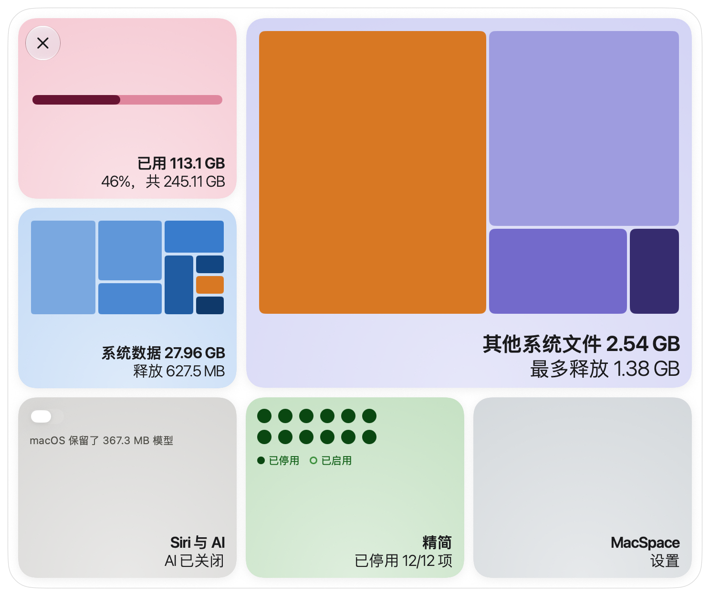
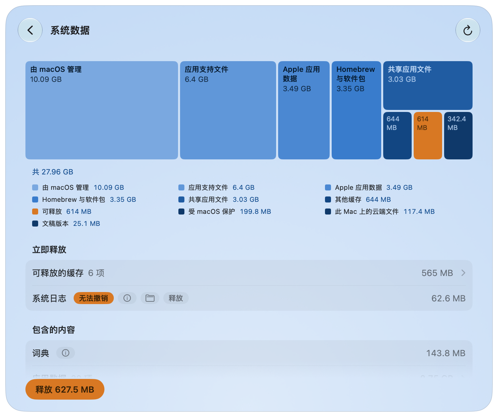
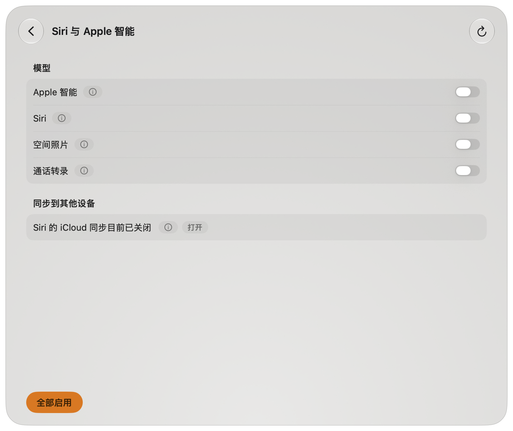
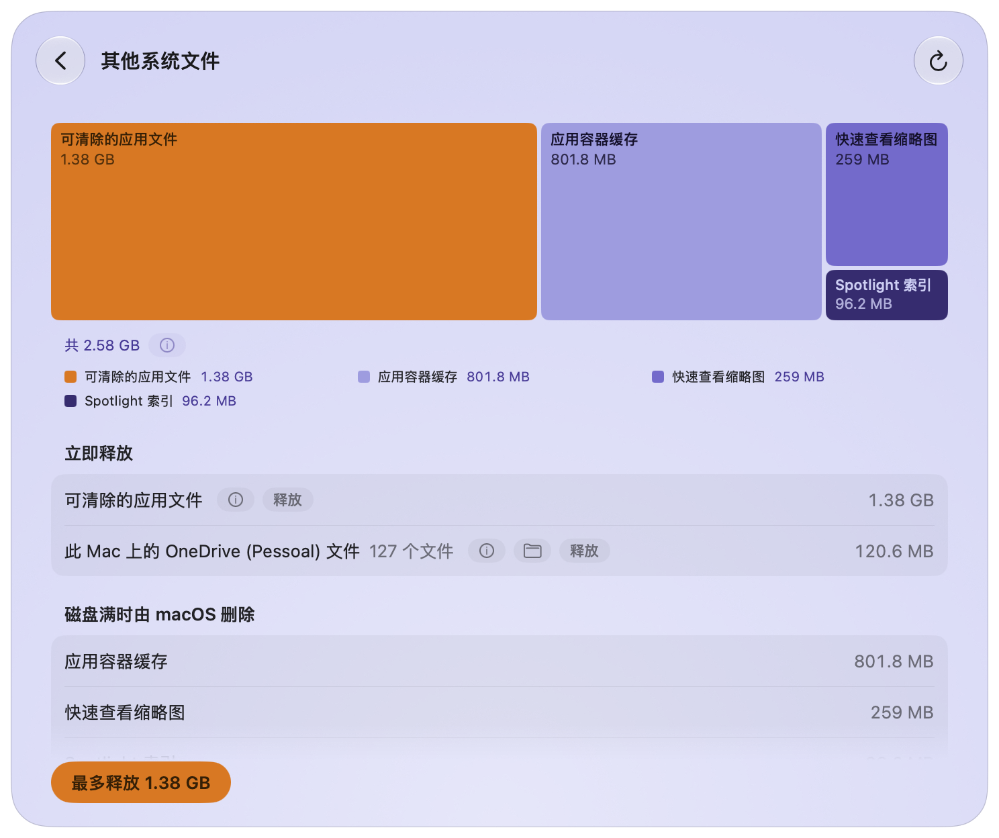
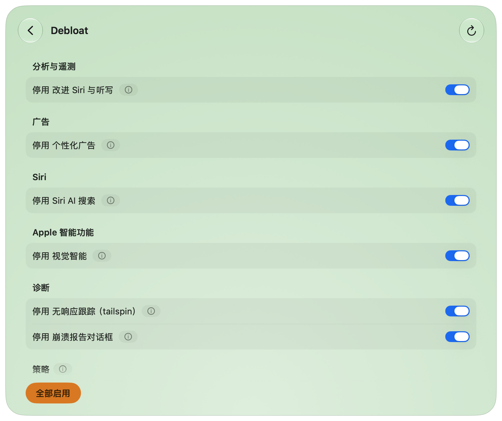
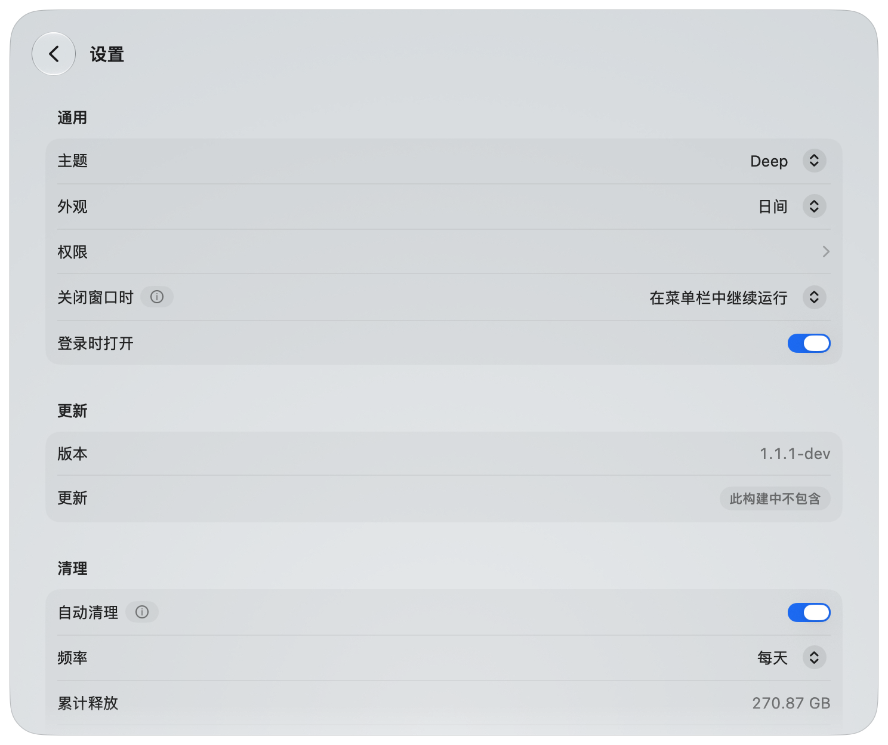
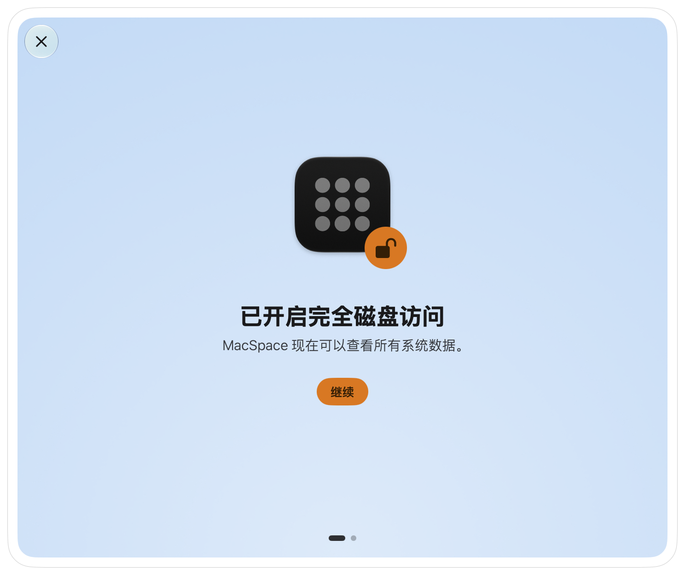

[English](../../../README.md) · [Português](../pt-BR/README.md) · [Español](../es/README.md) · [Français](../fr/README.md) · [Deutsch](../de/README.md) · **简体中文** · [日本語](../ja/README.md) · [한국어](../ko/README.md)

# MacSpace

**适用于 macOS 的“系统数据”与 Apple 智能清理工具。**

<p align="left">
<a href="https://trendshift.io/repositories/288700?utm_source=trendshift-badge&amp;utm_medium=badge&amp;utm_campaign=badge-trendshift-288700" target="_blank" rel="noopener noreferrer"></a>
</p>

[](https://github.com/1architect/macspace-releases/actions/workflows/ci.yml)
[](https://github.com/1architect/macspace-releases/releases/latest)
[](../../../LICENSE)


MacSpace 会显示是什么占满了“系统数据”，并释放可以安全删除的内容。它会关闭 Apple 智能，并删除
macOS 随后仍留在磁盘上的模型。它会释放被 App 标记为可清除的文件，还能关闭 macOS 允许你控制的
分析与后台数据收集。它免费、开源，并且**不会收集任何关于你的数据**。

[**下载 MacSpace**](#安装) ·
[隐私政策](PRIVACY.md) ·
[安全](SECURITY.md) ·
[更新日志](../../../CHANGELOG.md)（英文）

<p align="center">
  <picture>
    <source media="(prefers-color-scheme: dark)" srcset="Docs/Screenshots/zh-Hans/Home-Dark.png">
    
  </picture>
</p>

---

## 功能

MacSpace 有四个模块。你可以在“设置”中开启或关闭它们。

**系统数据。** “系统数据”是磁盘上“系统设置”没有解释的那一部分。MacSpace 的算法与“系统设置”相同
（已用空间减去 macOS 和其他所有类别），所以得到的数字与你在那里看到的很接近。然后它会把这部分
拆开：缓存、日志、报告、系统资源、App 数据、文稿版本历史。

主按钮**释放**会删除安全的内容。需要更加谨慎的项目有各自的按钮。对于属于 macOS 或其他 App 的
内容，MacSpace 会说明它是什么，以及该如何手动处理。App 缓存也可以选择：**释放**会在退出仍在运行
的 App 之前询问你。你也可以在 App 的设置中选择另一款已安装的清理工具，来代替 MacSpace 处理 App
缓存。

<p align="center">
  
</p>

**Siri 与 Apple 智能。** 关闭后，MacSpace 会把 Siri 设为与你的 Mac 不同的语言，macOS 就是这样判断
Apple 智能不可用的。随后 MacSpace 会删除 macOS 留在磁盘上的模型，大小可达约 12 GB。重新开启后，
MacSpace 会恢复你的 Siri 语言和语音。

另外三个开关会关闭以下功能，并删除它们留在磁盘上的模型：**Siri、空间照片和通话转录**。

<p align="center">
  
</p>

**其他系统文件。** 位于“系统数据”之外、被 macOS 计为可清除的空间。磁盘快满时，macOS 会自行释放它。
**最多释放**会让 macOS 立即执行清理。保存在这台 Mac 上的云文件副本（OneDrive、iCloud 云盘和其他
云端文件夹）有各自的一行和一个按钮，**移除下载**。文件仍保留在云端，打开时会重新下载。这个模块
还会清理过期的 macOS 更新和旧的 Time Machine 快照。

<p align="center">
  
</p>

**Debloat。** 十二个开关，针对分析、广告和后台数据收集。开关处于开启状态，表示 MacSpace 已关闭
该功能。MacSpace 运行期间，它每 15 分钟检查一次，并再次关闭被 macOS 重新开启的任何功能。

| 开关 | 作用 | 生效时间 |
|---|---|---|
| 与 Apple 共享分析 | 不再向 Apple 和 App 开发者发送使用情况和崩溃数据。 | 即时 |
| 改进 Siri 与听写 | 不再与 Apple 共享 Siri 和听写的录音。 | 即时 |
| 在 Apple 服务器上进行听写和翻译 | 听写和翻译只在这台 Mac 上进行。没有设备端模型的语言将无法使用。 | 重新打开 App 后 |
| 个性化广告 | Apple 不再根据你的行为来挑选广告。 | 重新打开 App 后 |
| 广告标识符 | App 无法用广告标识符追踪你，也无法请求它。 | 重新打开 App 后 |
| Siri AI 搜索 | 停止 Siri AI 搜索 App。聚焦搜索恢复为经典搜索。Siri 本身在“Siri 与 Apple 智能”页面中。 | 重新启动后 |
| 视觉智能 | 关闭视觉智能。“查询”也可能随之失效。 | 重新启动后 |
| Spotlight 互联网结果 | 聚焦搜索不再把你的搜索发送给 Apple，聚焦搜索中不再有网页结果。 | 重新打开 App 后 |
| 无响应跟踪（tailspin） | 阻止 macOS 为无响应报告而持续记录活动。可释放约 100 MB 内存。 | 即时 |
| 崩溃报告对话框 | 不再弹出“意外退出”对话框。 | 重新启动后 |
| Game Center | 关闭 Game Center。 | 退出登录后 |
| Apple News | 隐藏 Apple News 及其小组件。 | 退出登录后 |

其中五项是策略。停用其中一项时，需要你在“系统设置”中批准一次描述文件（参见[权限](#首次启动与权限)）。
在 macOS 测试版上，分析开关也是一项策略。

<p align="center">
  
</p>

**MacSpace 还有。** **自动清理**会在 MacSpace 运行期间，不经询问地释放各模块可以释放的内容。
**最近清理**提供已清理内容的历史记录。**关闭窗口时**，MacSpace 可以退出、继续留在菜单栏中（默认），
或在后台静默运行。右键点按菜单栏图标，即可快速进入各个模块。

---

## 安装

### Homebrew

```bash
brew install --cask 1architect/macspace/macspace
```

### 直接下载（DMG）

从 [Releases](https://github.com/1architect/macspace-releases/releases/latest) 下载最新的
`MacSpace-x.y.z.dmg`，打开后把 **MacSpace** 拖到“应用程序”文件夹。

每个版本还附带 `MacSpace-x.y.z.dmg.sha256`。要校验下载的文件，请把两个文件放在同一个文件夹里，然后运行：

```bash
shasum -a 256 -c MacSpace-x.y.z.dmg.sha256
```

它会输出 `MacSpace-x.y.z.dmg: OK`。MacSpace 使用 Developer ID 签名，并已通过 Apple 公证。
更多信息请参阅[安全](SECURITY.md)。

### 系统要求

macOS 27 或更高版本，Apple 芯片。

### 更新与设置

MacSpace 通过 [Sparkle](https://sparkle-project.org) 更新。在 MacSpace 菜单中选取**检查更新…**，或在
**设置 > 更新**下点按**立即检查**。同一位置的**自动检查更新**会让 MacSpace 在运行期间大约每天检查一次。
每个更新都有签名，Sparkle 会先验证签名再安装。

<p align="center">
  
</p>

---

## 首次启动与权限

全新安装后，MacSpace 会一次一个界面地引导你完成所需的步骤：**允许完全磁盘访问**、**批准辅助程序**、
**接收通知**，然后是**已准备就绪**。每一步都可以稍后再做（**稍后**），已完成的步骤会被跳过。你可以随时在
**设置 > 权限**中回到这些步骤。

<p align="center">
  
</p>

| 权限 | 在哪里授予 | MacSpace 为什么需要它 | 模块 |
|---|---|---|---|
| 完全磁盘访问 | 系统设置 > 隐私与安全性 > 完全磁盘访问权限 | 用于测量磁盘上的所有内容，并读取 Apple 智能的状态。 | 系统数据、Siri 与 Apple 智能 |
| 特权辅助程序 | 系统设置 > 通用 > 登录项与扩展，在**允许在后台**下 | 一个小程序，负责少数需要管理员权限的操作（见下文）。 | 系统数据、Siri 与 Apple 智能、Debloat |
| 通知 | 首次使用时 macOS 会询问 | 在某件事完成或需要你处理时通知你。 | 全部 |
| 配置描述文件 | 系统设置 > 通用 > 设备管理 | 应用你启用的 Debloat 策略。仅策略需要（五项；macOS 测试版为六项）。 | Debloat |

“其他系统文件”不需要自己的权限。所有授权都由 macOS 处理，所以 MacSpace 永远看不到你的密码。

辅助程序是一个启动守护进程（launch daemon），`com.macspace.helper`。它只执行内置的、有名称的操作，
调用方无法向它发送命令，并且它只接受与 MacSpace 由同一开发团队签名的客户端。更多信息请参阅
[安全](SECURITY.md)。

---

## 安全性

**MacSpace 会删除的项目**

- App 会重建的缓存：每个用户的系统缓存文件夹（`/var/folders/…/C`）中的缓存，以及 Chromium 和
  Electron App 保存在 `~/Library/Application Support` 中的网页缓存（`Cache`、`Code Cache`、
  `GPUCache`）。仅在拥有它们的 App 或工具（连同其辅助进程）已关闭，且没有任何程序打开其中的文件时才会删除。
- macOS 检查 App 时生成的副本（`/var/folders/…/X`），仅限 App 更新后这些副本自己占用的空间，并且仅在
  该 App 已关闭时。
- 超过 7 天的诊断和崩溃报告，位于 `/Library/Logs/DiagnosticReports` 和
  `~/Library/Logs/DiagnosticReports`。
- 未使用的系统资源、macOS 已释放的 Apple 智能模型，以及 App 标记为可清除的文件。MacSpace 向 macOS
  自己的清除服务提出请求，也就是磁盘快满时 macOS 运行的那个服务。需要时它们会重新下载。
- 仅当你按下它自己的按钮时：文稿版本历史、已安装的 macOS 更新遗留的文件、macOS 留下的未完成的壁纸和
  屏幕保护程序下载，以及云文件的本地副本。对于这些下载，辅助程序只会删除
  `/var/folders/…/T/com.apple.idleassetsd` 中 3 天内没有变化的 `CFNetworkDownload_*.tmp` 文件，因此仍在进行的
  下载会保留。
- 仅当你按下它自己的按钮时：系统日志（使用 Apple 自己的 `log erase`）；macOS 为读取崩溃报告而保留的符号
  （它会重新生成）；废纸篓中的所有内容；Time Machine 的本地快照（保留最新的一个，以及下一次备份所基于
  的那一个）；以及你在已连接的备份磁盘上选择的备份（始终保留最新的一个）。备份运行期间绝不会删除快照和备份。
- 仅限你在 **App 缓存**下选择的缓存：`~/Library/Caches` 中的文件夹，以及（在有完全磁盘访问权限时）每个
  App 容器的缓存文件夹中的内容（`~/Library/Containers/<app>/Data/Library/Caches`），但不包括 macOS 保留在那里的
  内容。绝不包括 Apple 的缓存。为你预先勾选的缓存一个月内没有变化，并且它们的 App 在同样长的时间里没有被
  打开，或者没有安装。正在使用的缓存会以未勾选状态列出，并说明它们会重新生成。正在运行的 App 的缓存也可以
  勾选：**释放**会指出该 App，请它退出（它可能会请你保存，你也可以取消），然后释放它的缓存。自动清理绝不会
  退出 App。包含媒体或由用户命名的文稿的文件夹不会被列出。
- 仅限**Homebrew**一行：Homebrew 自己的 `brew cleanup`，以你的身份运行，不会卸载 formula，不会更新，也不会发送
  Homebrew 的分析数据。

**不会触碰的项目。** MacSpace 只测量你的文稿、照片、邮件和信息占用了多少空间。它会列出大型项目，例如未
完成的下载、macOS 恢复映像和虚拟机。它不会动其他 App 的数据，只会说明如何在该 App 内清理。**它不会读取或删除
你的个人文件。它不会关闭系统完整性保护，也不会更改已封存的系统宗卷。**

**使用过程中的权限。** 每个会删除多个 App 缓存的按钮都会请求确认。文稿版本历史、系统日志、废纸篓以及
Time Machine 快照和备份上的**释放**带有**无法撤销**标记。**Apple 智能**开关和单个 Debloat 开关会立即生效，
如果更改失败，会自动恢复原状。

**可撤销的操作。** Debloat：重新开启该功能，或按下**全部启用**。MacSpace 会恢复它在更改前保存的设置。
Apple 智能和与 Siri 相关的选项：重新开启即可。MacSpace 会恢复你的 Siri 语言和语音，macOS 可能会再次
下载模型。删除的缓存会重新生成。删除的报告、版本历史、日志、废纸篓中的项目、快照和备份无法恢复。

macOS 的行为及测量结果见 [Docs/Research.md](../../../Docs/Research.md)（英文）。

---

## 隐私

MacSpace 没有分析、没有遥测、没有崩溃报告，也没有账户。它测量的内容、你的清理历史和你的设置都保存在你的
Mac 上，位于 `~/Library/Application Support/MacSpace/`。网络只用于一件事：更新。MacSpace 会读取 GitHub 上的
一个小型更新源，并且在你接受更新时从 GitHub 下载。它不会发送系统概况，也不会发送任何标识符。它写入的每个
文件和读取的所有内容，都列在[隐私政策](PRIVACY.md)和[安全政策](SECURITY.md)中。

---

## 卸载

要**卸载**，请使用 MacSpace 的卸载程序。在菜单栏中点按 **MacSpace**，然后选取**关于 MacSpace**，再点按
**卸载**。卸载程序会自动完成下面的流程。

如果你想手动操作，请按以下顺序进行：

1. **撤销 MacSpace 所做的更改。** 在 **Debloat** 中按下**全部启用**。这也会移除 Debloat 写在 MacSpace 自己的
   文件夹之外的覆盖设置；如果你只是删除 App，这些设置会留在原处。如果需要重新启动，页面会提示。如果你关闭了
   Apple 智能、Siri、空间照片或通话转录并想恢复，请在 **Siri 与 Apple 智能**中开启它们。
2. **移除描述文件**（如果仍安装着）：在“系统设置 > 通用 > 设备管理”中，选择 **MacSpace: policies**
   （标识符 `com.macspace.policies`）并移除。
3. **退出 MacSpace**（MacSpace 菜单中的**退出 MacSpace**，或菜单栏图标的菜单）。移除辅助程序：在“系统设置 >
   通用 > 登录项与扩展”中关闭 MacSpace，或在删除 App 之前运行：
   ```bash
   /Applications/MacSpace.app/Contents/MacOS/MacSpaceCli helper --unregister
   ```
4. **移除 App：** `brew uninstall --cask macspace`（加上 `--zap` 还会移除它的数据和偏好设置），或把
   **MacSpace** 从“应用程序”拖到废纸篓。
5. **移除它的数据和偏好设置：**
   ```bash
   rm -rf ~/Library/Application\ Support/MacSpace ~/Library/Logs/MacSpace ~/Library/Caches/com.macspace.app
   defaults delete com.macspace.app
   sudo rm -rf /Library/Application\ Support/MacSpace
   ```
   最后一行仅在你使用过 Debloat 或通话转录，或移除过遗留的 Apple 智能订阅时才需要。请在第 1 步之后运行：
   该文件夹保存着 MacSpace 要恢复的原始设置。
6. **移除完全磁盘访问权限：** 在“系统设置 > 隐私与安全性 > 完全磁盘访问权限”中，选择 MacSpace 并按下减号按钮。

---

## 从源代码构建

源代码就是这个仓库。[Docs/Handoff.md](../../../Docs/Handoff.md)（英文）说明了它的结构。你需要 macOS 27 和 Xcode 27。

```bash
export DEVELOPER_DIR=/Applications/Xcode-beta.app/Contents/Developer
swift test
INSTALL=1 Scripts/Assemble.sh
```

最后一条命令会构建 `Build/MacSpace.app` 并把它复制到 `/Applications`。没有 Developer ID 证书时，构建使用临时
签名（ad hoc）且不会公证，每次构建后 macOS 都会再次请求完全磁盘访问权限。你自己构建的版本没有更新密钥，
因此不会检查更新。

---

## 支持与贡献

**dev@giomantovani.com.br**

错误、想法和翻译错误：[GitHub Issues](https://github.com/1architect/macspace-releases/issues)。
安全问题：切勿公开提交 issue，请参阅 [SECURITY.md](SECURITY.md)。要参与贡献，请阅读
[CONTRIBUTING.md](../../../CONTRIBUTING.md)（英文）。所有参与者都遵守[行为准则](../../../CODE_OF_CONDUCT.md)（英文）。
各项更改列在[更新日志](../../../CHANGELOG.md)中。

---

## 许可证

MacSpace 是依据 MIT 许可证发布的自由软件。Copyright (c) 2026 1architect。参见 [LICENSE](../../../LICENSE)（英文）。
英文文本具有约束力，`Docs/Translations/<language>/LICENSE.md` 中的译文仅供参考。第三方声明见 [NOTICE](../../../NOTICE)（英文）。

MacSpace 与 Apple 无关联。Apple Intelligence、Siri 和 macOS 是 Apple Inc. 的商标。
