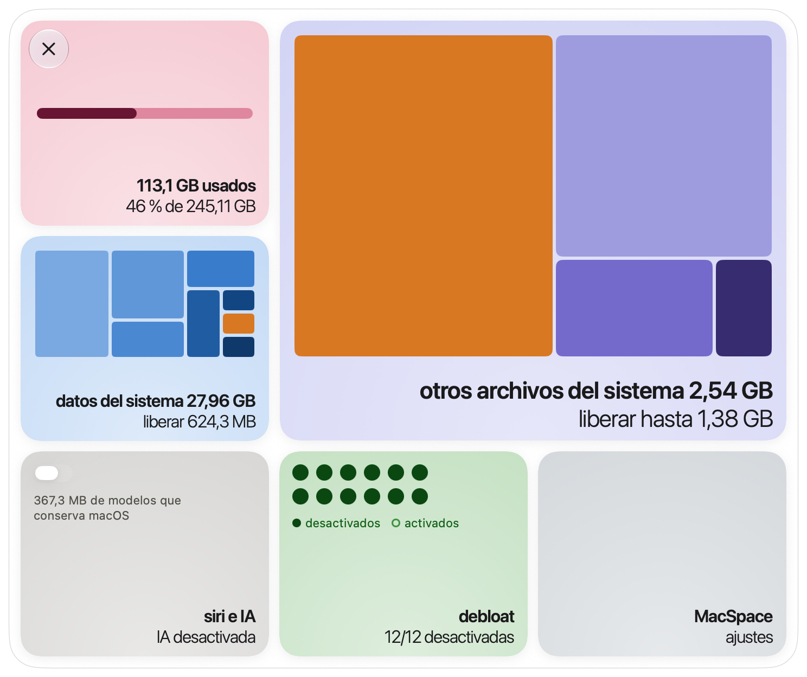
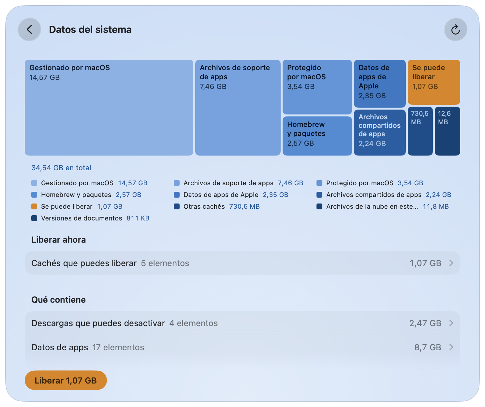
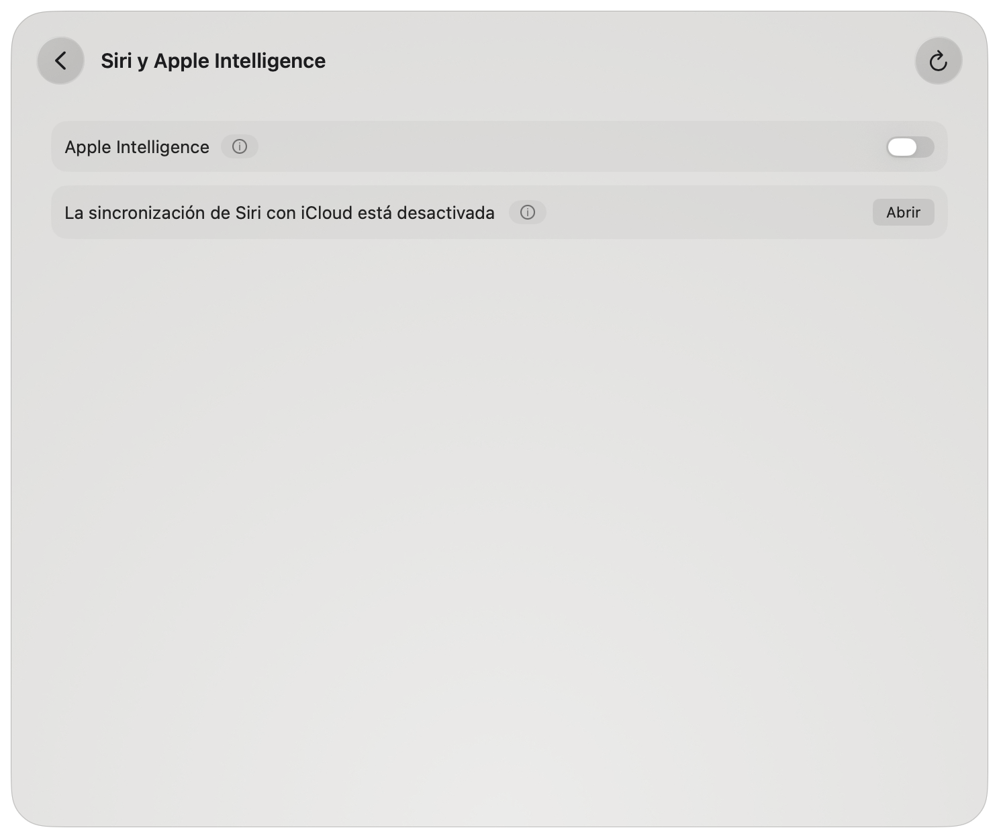
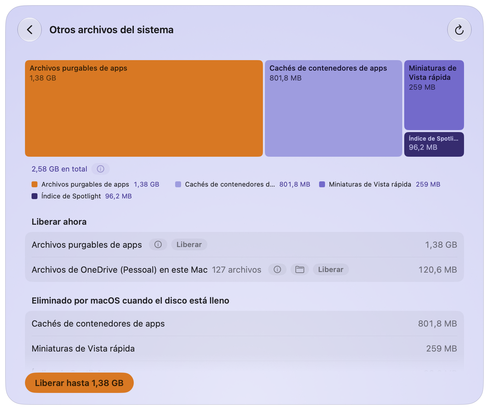
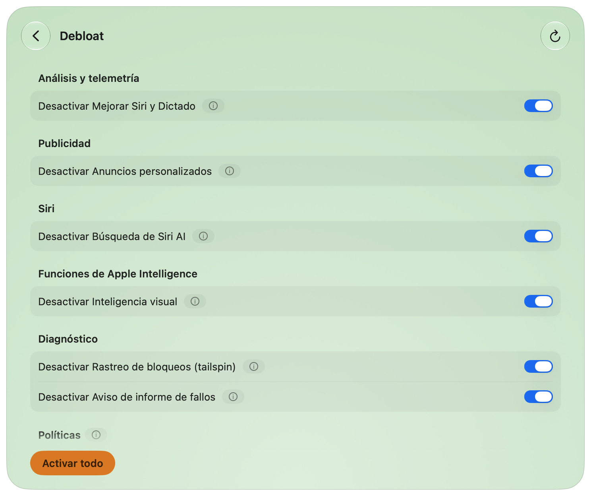
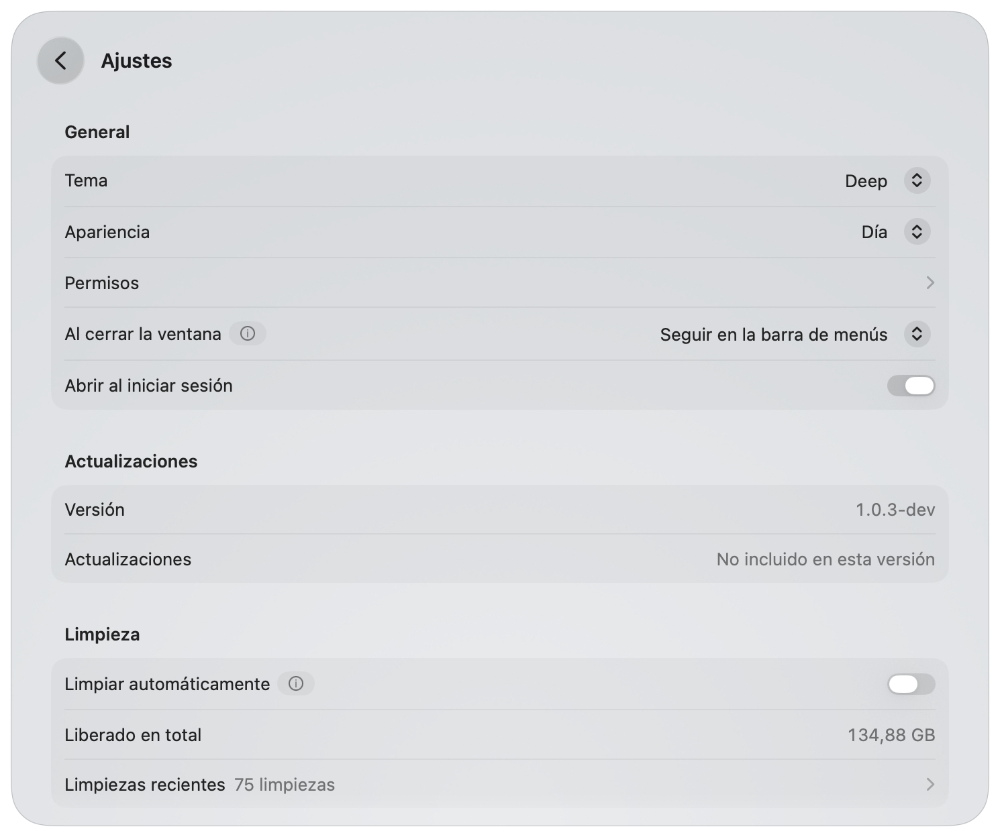
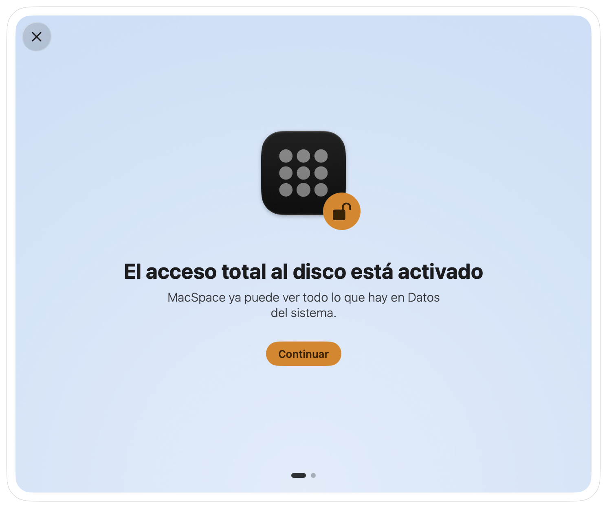

[English](README.md) · [Português](README.pt-BR.md) · **Español** · [Français](README.fr.md) · [Deutsch](README.de.md) · [简体中文](README.zh-Hans.md) · [日本語](README.ja.md) · [한국어](README.ko.md)

# MacSpace

**Un limpiador de Datos del sistema y de Apple Intelligence para macOS.**

<p align="left">
<a href="https://trendshift.io/repositories/288700?utm_source=trendshift-badge&amp;utm_medium=badge&amp;utm_campaign=badge-trendshift-288700" target="_blank" rel="noopener noreferrer"></a>
</p>

[](https://github.com/1architect/macspace-releases/actions/workflows/ci.yml)
[](https://github.com/1architect/macspace-releases/releases/latest)
[](LICENSE)


MacSpace muestra qué ocupa Datos del sistema y libera lo que se puede eliminar sin riesgo.
Desactiva Apple Intelligence y elimina después los modelos que macOS conserva en el disco.
Libera los archivos que las apps marcaron como purgables, y puede desactivar los análisis y la
recogida de datos en segundo plano que macOS te deja controlar. Es gratis y de código abierto, y
**no recoge ningún dato sobre ti**.

[**Descargar MacSpace**](#instalar) ·
[Política de Privacidad](PRIVACY.es.md) ·
[Seguridad](SECURITY.es.md) ·
[Registro de cambios](CHANGELOG.md) (en inglés)

<p align="center">
  <picture>
    <source media="(prefers-color-scheme: dark)" srcset="Docs/Screenshots/es/Home-Dark.png">
    
  </picture>
</p>

---

## Qué hace

MacSpace tiene cuatro módulos. Puedes activarlos o desactivarlos en Ajustes.

**Datos del sistema.** Datos del sistema es la parte del disco que Ajustes del Sistema no explica.
MacSpace la calcula igual que Ajustes del Sistema (espacio usado, menos macOS y todas las demás
categorías), así que la cifra se acerca a la que ves allí. Después la desglosa: cachés, registros,
informes, recursos del sistema, datos de apps, historial de versiones de documentos.

El botón principal, **Liberar**, elimina lo que es seguro. Los elementos que piden más cuidado
tienen sus propios botones. Para todo lo que pertenece a macOS o a otras apps, MacSpace dice qué es
y qué hacer a mano. También se pueden elegir las cachés de las apps: **Liberar** pregunta antes de
cerrar una app abierta. O, en los ajustes de la app, elige otro limpiador instalado para que se
encargue de las cachés de las apps en lugar de MacSpace.

<p align="center">
  
</p>

**Siri y Apple Intelligence.** Desactivado, MacSpace pone Siri en un idioma distinto del de tu Mac.
Así es como macOS decide que Apple Intelligence no está disponible. Después MacSpace elimina los
modelos que macOS conserva en el disco, que pueden ocupar unos 12 GB. Vuelve a activarlo y MacSpace
restituye el idioma y la voz de Siri.

Otros tres interruptores desactivan las siguientes funciones y eliminan los modelos que quedan en el
disco: **Siri, Fotos espaciales y Transcripción de llamadas**.

<p align="center">
  
</p>

**Otros archivos del sistema.** Espacio fuera de Datos del sistema que macOS cuenta como purgable.
macOS lo libera cuando el disco está casi lleno. **Liberar hasta** hace que macOS haga la limpieza
ahora. Las copias de archivos de la nube guardadas en este Mac (OneDrive, iCloud Drive y otras
carpetas de la nube) tienen una fila y un botón propios, **Eliminar descargas**. Los archivos siguen
en la nube y se descargan de nuevo cuando los abres. Este módulo también limpia actualizaciones
antiguas de macOS e instantáneas antiguas de Time Machine.

<p align="center">
  
</p>

**Debloat.** Doce interruptores para análisis, publicidad y recogida de datos en segundo plano. Si el
interruptor está activado, significa que MacSpace desactivó esa función. Mientras MacSpace está
abierto, comprueba cada 15 minutos y vuelve a desactivar todo lo que macOS haya reactivado.

| Interruptor | Qué hace | Surte efecto después de |
|---|---|---|
| Compartir análisis con Apple | Deja de enviar datos de uso y de fallos a Apple y a los desarrolladores. | Nada |
| Mejorar Siri y Dictado | Deja de compartir las grabaciones de Siri y del dictado con Apple. | Nada |
| Dictado y traducción en los servidores de Apple | El dictado y la traducción se quedan en este Mac. Los idiomas sin modelo en el dispositivo dejan de funcionar. | Volver a abrir las apps |
| Anuncios personalizados | Apple deja de elegir anuncios según lo que haces. | Volver a abrir las apps |
| Identificador de publicidad | Las apps no pueden rastrearte con el identificador de publicidad ni pedirlo. | Volver a abrir las apps |
| Búsqueda de Siri AI | Detiene la app de búsqueda de Siri AI. Spotlight vuelve a la búsqueda clásica. Siri en sí está en la página Siri y Apple Intelligence. | Un reinicio |
| Inteligencia visual | Desactiva la Inteligencia visual. Es posible que Buscar visualmente también deje de funcionar. | Un reinicio |
| Resultados de internet en Spotlight | Spotlight deja de enviar tus búsquedas a Apple. Sin resultados web en Spotlight. | Volver a abrir las apps |
| Rastreo de bloqueos (tailspin) | Impide que macOS grabe actividad constantemente para los informes de bloqueos. Libera unos 100 MB de memoria. | Nada |
| Aviso de informe de fallos | Se acabaron los avisos de «se cerró inesperadamente». | Un reinicio |
| Game Center | Desactiva Game Center. | Cerrar sesión |
| Apple News | Oculta Apple News y sus widgets. | Cerrar sesión |

Cinco de ellos son políticas. Desactivar una te pide aprobar una vez un perfil en Ajustes del
Sistema (consulta [Permisos](#primer-arranque-y-permisos)). En la beta de macOS, el interruptor de
análisis también es una política.

<p align="center">
  
</p>

**También en MacSpace.** **Limpiar automáticamente** libera, sin preguntar, lo que los módulos
pueden liberar, mientras MacSpace está abierto. **Limpiezas recientes** muestra el historial de lo
que se limpió. **Al cerrar la ventana**, MacSpace puede salir, seguir en la barra de menús (lo
predeterminado) o seguir en segundo plano sin mostrarse. Haz clic derecho en el icono de la barra
de menús para acceder fácilmente a cada módulo.

---

## Instalar

### Homebrew

```bash
brew install --cask 1architect/macspace/macspace
```

### Descarga directa (DMG)

Descarga el `MacSpace-x.y.z.dmg` más reciente desde
[Releases](https://github.com/1architect/macspace-releases/releases/latest), ábrelo y arrastra
**MacSpace** a la carpeta Aplicaciones.

Cada versión también incluye `MacSpace-x.y.z.dmg.sha256`. Para comprobar tu descarga, pon ambos
archivos en la misma carpeta y ejecuta:

```bash
shasum -a 256 -c MacSpace-x.y.z.dmg.sha256
```

Imprime `MacSpace-x.y.z.dmg: OK`. MacSpace está firmado con un Developer ID y notarizado por Apple.
Consulta [Seguridad](SECURITY.es.md) para más información.

### Requisitos

macOS 27 o posterior, en Apple Silicon.

### Actualizaciones y ajustes

MacSpace se actualiza con [Sparkle](https://sparkle-project.org). Elige **Buscar actualizaciones…**
en el menú MacSpace, o **Comprobar ahora** en **Ajustes > Actualizaciones**. **Buscar
actualizaciones automáticamente**, en el mismo lugar, hace que MacSpace busque una vez al día
aproximadamente mientras se ejecuta. Cada actualización está firmada, y Sparkle comprueba la firma
antes de instalar nada.

<p align="center">
  
</p>

---

## Primer arranque y permisos

En una instalación nueva, MacSpace empieza por lo que necesita, una pantalla cada vez: **Permitir
acceso total al disco**, **Aprueba el asistente**, **Recibe avisos** y, por último, **Todo listo**.
Cada paso puede esperar (**Más tarde**), y los pasos que ya hiciste se omiten. Puedes volver a
ellos en **Ajustes > Permisos**.

<p align="center">
  
</p>

| Permiso | Dónde se concede | Por qué lo necesita MacSpace | Módulos |
|---|---|---|---|
| Acceso total al disco | Ajustes del Sistema > Privacidad y seguridad > Acceso total al disco | Para medir todo lo que hay en el disco y para leer el estado de Apple Intelligence. | Datos del sistema, Siri y Apple Intelligence |
| Asistente con privilegios | Ajustes del Sistema > General > Ítems de inicio y extensiones, en **Permitir en segundo plano** | Un pequeño programa que realiza las pocas tareas que requieren un administrador (ver abajo). | Datos del sistema, Siri y Apple Intelligence, Debloat |
| Notificaciones | macOS lo pide la primera vez | Para avisarte cuando algo ha terminado o te necesita. | Todos |
| Perfil de configuración | Ajustes del Sistema > General > Gestión de dispositivos | Aplica las políticas de Debloat que actives. Solo hace falta para las políticas (cinco; seis en una beta de macOS). | Debloat |

Otros archivos del sistema no necesita ningún permiso propio. macOS gestiona toda autorización, así
que MacSpace nunca ve tu contraseña.

El asistente es un daemon de arranque (launch daemon), `com.macspace.helper`. Solo ejecuta
operaciones con nombre que lleva incorporadas, quien lo llama no puede enviarle comandos y solo
acepta clientes firmados por el mismo equipo de desarrollo que MacSpace. Consulta
[Seguridad](SECURITY.es.md) para más información.

---

## Uso seguro

**Elementos que MacSpace elimina**

- Cachés que las apps vuelven a crear: las cachés de la carpeta de caché del sistema de cada
  usuario (`/var/folders/…/C`) y las cachés web (`Cache`, `Code Cache`, `GPUCache`) que las apps
  de Chromium y Electron guardan en `~/Library/Application Support`. Solo mientras la app o la herramienta a la
  que pertenecen está cerrada, con sus procesos auxiliares, y ningún programa tiene un archivo abierto en ellas.
- Las copias que macOS hace de una app al comprobarla (`/var/folders/…/X`), por el espacio que
  ocupan por sí solas cuando la app se actualizó, y solo mientras la app está cerrada.
- Informes de diagnóstico y de fallos con más de 7 días, en `/Library/Logs/DiagnosticReports` y
  `~/Library/Logs/DiagnosticReports`.
- Recursos del sistema sin usar, modelos de Apple Intelligence que macOS ha liberado y archivos
  que las apps marcaron como purgables. MacSpace se los pide al propio servicio de purga de
  macOS, el que macOS ejecuta cuando el disco está casi lleno. Se vuelven a descargar si hacen
  falta.
- Solo cuando pulsas su propio botón: el historial de versiones de documentos, los archivos
  sobrantes de una actualización de macOS ya instalada, las descargas de fondos de pantalla y
  salvapantallas que macOS dejó sin terminar y las copias locales de archivos de la nube. De las
  descargas, el asistente elimina solo los archivos `CFNetworkDownload_*.tmp` de
  `/var/folders/…/T/com.apple.idleassetsd` que no han cambiado en 3 días, así que una descarga en
  curso se queda.
- Solo cuando pulsas su propio botón: el registro del sistema, con el `log erase` de Apple; los
  símbolos que macOS guarda para leer informes de fallos, que vuelve a crear; todo lo que hay en la
  Papelera; las instantáneas locales de Time Machine, menos la más reciente y la que usa como punto
  de partida la próxima copia; y las copias que elijas en un disco de copia conectado, nunca la más
  reciente. Instantáneas y copias nunca se eliminan durante una copia.
- Solo las cachés que eliges en **Cachés de apps**: carpetas de `~/Library/Caches` y, con acceso
  total al disco, lo que hay en la carpeta de cachés del contenedor de cada app
  (`~/Library/Containers/<app>/Data/Library/Caches`), salvo lo que macOS guarda allí. Nunca las de
  Apple. Las que vienen marcadas no cambian desde hace un mes, y su app no se abre desde hace tanto
  o no está instalada. Las cachés en uso aparecen sin marcar y avisan de que vuelven. Las cachés de
  una app abierta también se pueden marcar: **Liberar** nombra la app, le pide que se cierre (puede
  pedirte que guardes, y puedes cancelar) y después libera su caché. La limpieza automática nunca
  cierra una app. No se ofrecen las carpetas con archivos multimedia o documentos con nombres que
  les dan las personas.
- Solo desde la fila **Homebrew**: el `brew cleanup` del propio Homebrew, ejecutado como tú, sin
  desinstalar fórmulas, actualizar ni enviar las estadísticas de Homebrew.

**Elementos que no toca.** MacSpace solo mide cuánto espacio ocupan tus documentos, Fotos, Mail y
Mensajes. Lista elementos grandes, como descargas sin terminar, imágenes de restauración de macOS y
máquinas virtuales. Deja en paz los datos de otras apps y dice cómo limpiarlos desde la propia app.
**No lee ni elimina tus archivos personales. No desactiva la Protección de integridad del sistema ni
cambia el volumen del sistema sellado.**

**Permisos durante el uso.** Todo botón que elimina las cachés de más de una app pide confirmación.
**Liberar** en el historial de versiones de documentos, el registro del sistema, la Papelera y las
instantáneas y copias de seguridad de Time Machine lleva la etiqueta **No se puede deshacer**. El
interruptor de **Apple Intelligence** y cada interruptor de Debloat actúan al instante y vuelven
solos al estado anterior si el cambio falla.

**Acciones reversibles.** Debloat: vuelve a activar la función o pulsa **Activar todo**. MacSpace
restablece los ajustes que guardó antes de cambiarlos. Apple Intelligence y las opciones de Siri:
vuelve a activarlas. MacSpace restituye el idioma y la voz de Siri, y macOS puede descargar los
modelos otra vez. Las cachés eliminadas se reconstruyen. Los informes, el historial de versiones,
los registros, los elementos de la Papelera, las instantáneas y las copias de seguridad eliminados
no se recuperan.

---

## Privacidad

MacSpace no tiene análisis de uso, ni telemetría, ni informes de fallos, ni cuentas. Lo que mide,
tu historial de limpiezas y tus ajustes se quedan en tu Mac, en
`~/Library/Application Support/MacSpace/`. La red se usa para una sola cosa: las actualizaciones.
MacSpace lee un pequeño feed de actualizaciones en GitHub y, si aceptas una actualización, la
descarga de GitHub. No envía ningún perfil del sistema ni ningún identificador. Todos los
archivos que escribe, y todo lo que lee, están en la [Política de Privacidad](PRIVACY.es.md) y en
la [Política de Seguridad](SECURITY.es.md).

---

## Desinstalar

Para **desinstalar**, usa el desinstalador de MacSpace. En la barra de menús, pulsa **MacSpace**,
luego **Acerca de MacSpace** y haz clic en **Desinstalar**. El desinstalador automatiza el proceso
siguiente.

Si prefieres hacerlo a mano, sigue este orden:

1. **Deshaz lo que MacSpace cambió.** En **Debloat**, pulsa **Activar todo**. Esto también elimina
   los ajustes que Debloat escribió fuera de las carpetas propias de MacSpace, que se quedan si
   solo borras la app. Si hace falta reiniciar, la página lo dice. Si desactivaste Apple
   Intelligence, Siri, Fotos espaciales o Transcripción de llamadas y quieres recuperarlos,
   actívalos en **Siri y Apple Intelligence**.
2. **Elimina el perfil**, si aún hay uno instalado: en Ajustes del Sistema > General > Gestión de
   dispositivos, selecciona **MacSpace: policies** (identificador `com.macspace.policies`) y
   elimínalo.
3. **Sal de MacSpace** (**Salir de MacSpace** en el menú MacSpace, o en el menú de su icono de la
   barra de menús). Elimina el asistente: desactiva MacSpace en Ajustes del Sistema > General >
   Ítems de inicio y extensiones, o ejecuta esto antes de borrar la app:
   ```bash
   /Applications/MacSpace.app/Contents/MacOS/MacSpaceCli helper --unregister
   ```
4. **Elimina la app:** `brew uninstall --cask macspace` (añade `--zap` para eliminar también sus
   datos y preferencias), o arrastra **MacSpace** desde Aplicaciones a la Papelera.
5. **Elimina sus datos y preferencias:**
   ```bash
   rm -rf ~/Library/Application\ Support/MacSpace ~/Library/Logs/MacSpace ~/Library/Caches/com.macspace.app
   defaults delete com.macspace.app
   sudo rm -rf /Library/Application\ Support/MacSpace
   ```
   La última línea solo hace falta si usaste Debloat o la Transcripción de llamadas, o eliminaste
   suscripciones sobrantes de Apple Intelligence. Ejecútala después del paso 1: esa carpeta guarda
   los originales que MacSpace restituye.
6. **Quita el Acceso total al disco:** en Ajustes del Sistema > Privacidad y seguridad > Acceso
   total al disco, selecciona MacSpace y pulsa el botón de menos.

---

## Compilar desde el código fuente

El código fuente es este repositorio. Necesitas macOS 27 y Xcode 27.

```bash
export DEVELOPER_DIR=/Applications/Xcode-beta.app/Contents/Developer
swift test
INSTALL=1 Scripts/Assemble.sh
```

El último comando compila `Build/MacSpace.app` y lo copia en `/Applications`. Sin un certificado
de Developer ID, la compilación se firma ad hoc y no se notariza, y macOS vuelve a pedir el
acceso total al disco después de cada compilación. Una compilación que haces tú mismo no tiene
clave de actualización, así que nunca busca actualizaciones.

---

## Soporte y contribuciones

**dev@giomantovani.com.br**

Errores, ideas y traducciones incorrectas: [GitHub Issues](https://github.com/1architect/macspace-releases/issues).
Problemas de seguridad: nunca en una incidencia pública, consulta [SECURITY.es.md](SECURITY.es.md).
Para contribuir, lee [CONTRIBUTING.md](CONTRIBUTING.md) (en inglés). Todas las personas que
participan siguen el [Código de Conducta](CODE_OF_CONDUCT.md) (en inglés). Los cambios se
enumeran en el [Registro de cambios](CHANGELOG.md).

---

## Licencia

MacSpace es software libre con licencia MIT. Copyright (c) 2026 1architect. Consulta
[LICENSE](LICENSE) (en inglés). El texto en inglés es el único vinculante. Las traducciones de
`LICENSE.<language>.md` son de cortesía. Los avisos de terceros están en [NOTICE](NOTICE) (en
inglés).

MacSpace no está afiliado a Apple. Apple Intelligence, Siri y macOS son marcas comerciales de
Apple Inc.
