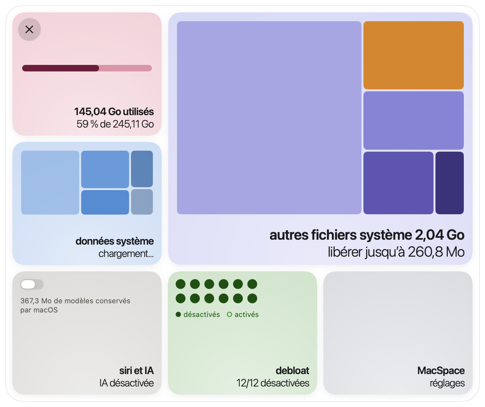
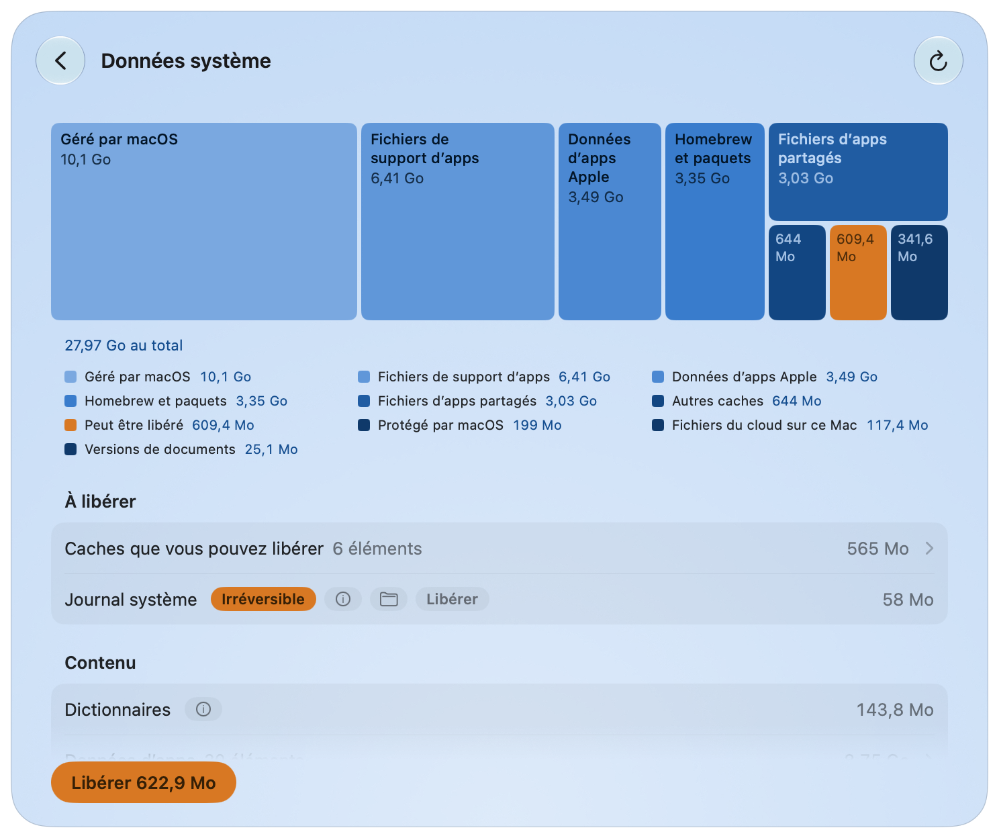
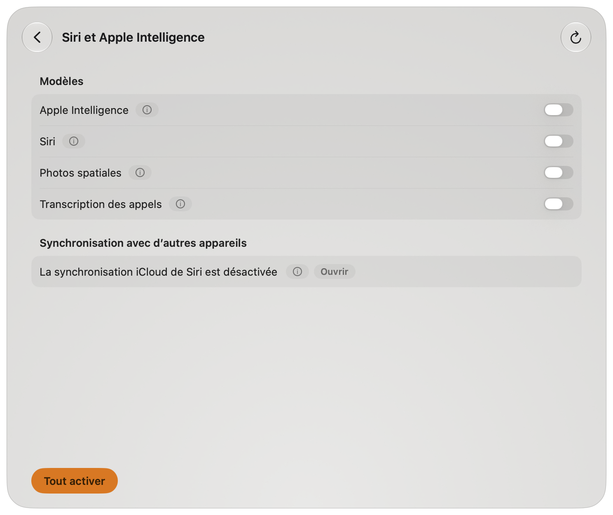
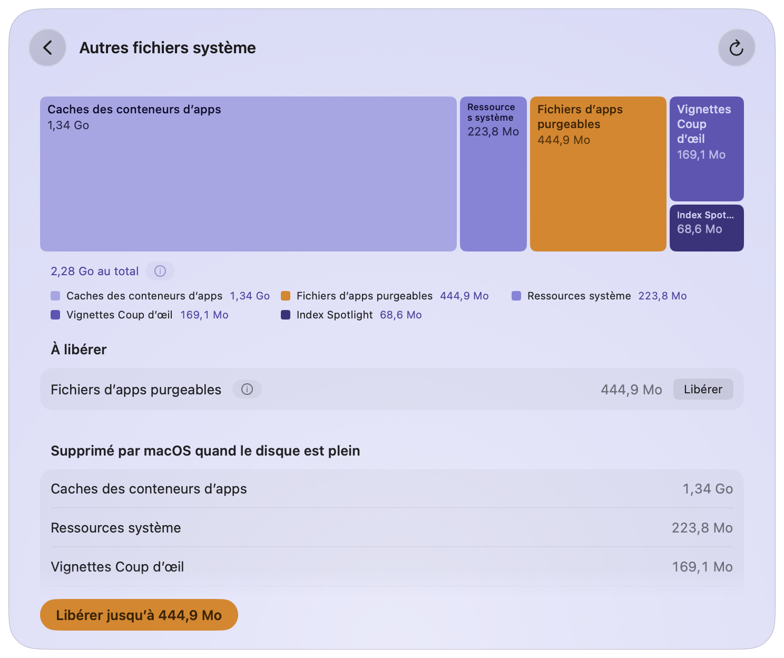
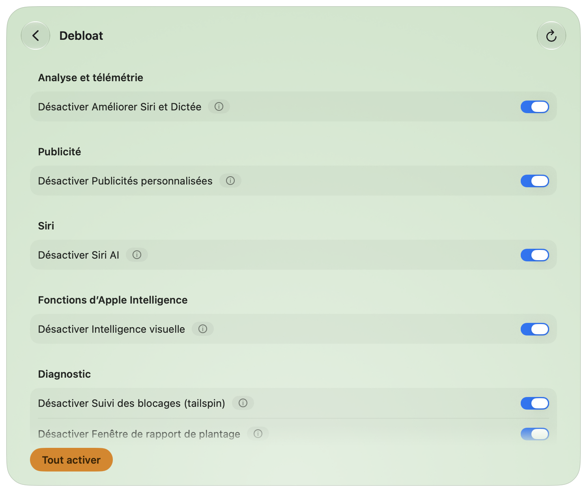
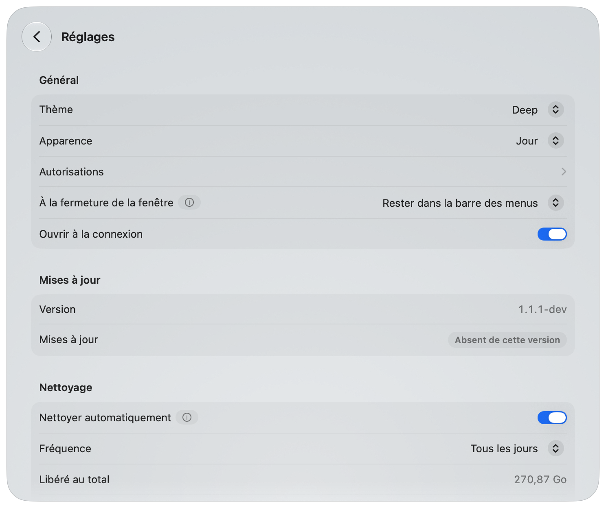

[English](README.md) · [Português](README.pt-BR.md) · [Español](README.es.md) · **Français** · [Deutsch](README.de.md) · [简体中文](README.zh-Hans.md) · [日本語](README.ja.md) · [한국어](README.ko.md)

# MacSpace

**Un outil de nettoyage de Données système et d’Apple Intelligence pour macOS.**

<p align="left">
<a href="https://trendshift.io/repositories/288700?utm_source=trendshift-badge&amp;utm_medium=badge&amp;utm_campaign=badge-trendshift-288700" target="_blank" rel="noopener noreferrer"></a>
</p>

[](https://github.com/1architect/macspace-releases/actions/workflows/ci.yml)
[](https://github.com/1architect/macspace-releases/releases/latest)
[](LICENSE)


MacSpace montre ce qui remplit Données système et libère ce qui peut être supprimé sans risque. Il
désactive Apple Intelligence et supprime ensuite les modèles que macOS garde sur le disque. Il
libère les fichiers que les apps ont marqués comme purgeables, et il peut désactiver les analyses
et la collecte de données en arrière-plan que macOS vous laisse contrôler. Il est gratuit et
open source, et il **ne collecte aucune donnée sur vous**.

[**Télécharger MacSpace**](#installation) ·
[Politique de confidentialité](PRIVACY.fr.md) ·
[Sécurité](SECURITY.fr.md) ·
[Journal des modifications](CHANGELOG.md) (en anglais)

<p align="center">
  <picture>
    <source media="(prefers-color-scheme: dark)" srcset="Docs/Screenshots/fr/Home-Dark.png">
    
  </picture>
</p>

---

## Ce que fait MacSpace

MacSpace compte quatre modules. Vous pouvez les activer ou les désactiver dans les Réglages.

**Données système.** Données système est la partie du disque que Réglages Système n’explique pas.
MacSpace la calcule comme Réglages Système (espace utilisé, moins macOS et toutes les autres
catégories), si bien que le chiffre est proche de celui que vous y voyez. Puis il la détaille :
caches, journaux, rapports, ressources système, données d’apps, historique des versions de
documents.

Le bouton principal, **Libérer**, supprime ce qui est sûr. Les éléments qui demandent plus de
précautions ont leurs propres boutons. Pour tout ce qui appartient à macOS ou à d’autres apps,
MacSpace dit ce que c’est et ce qu’il faut faire à la main. Les caches des apps peuvent aussi être
choisis : **Libérer** demande avant de quitter une app ouverte. Ou bien choisissez, dans les
réglages de l’app, un autre outil de nettoyage installé pour s’occuper des caches des apps à la
place de MacSpace.

<p align="center">
  
</p>

**Siri et Apple Intelligence.** Désactivé, MacSpace règle Siri sur une autre langue que celle de
votre Mac. C’est ainsi que macOS décide qu’Apple Intelligence n’est pas disponible. MacSpace
supprime ensuite les modèles que macOS garde sur le disque, ce qui peut représenter environ 12 Go.
Réactivez-le et MacSpace rétablit la langue et la voix de Siri.

Trois autres interrupteurs désactivent les fonctions suivantes et suppriment les modèles restés sur
le disque : **Siri, Photos spatiales et Transcription des appels**.

<p align="center">
  
</p>

**Autres fichiers système.** Espace situé hors de Données système que macOS compte comme purgeable.
macOS le libère quand le disque est presque plein. **Libérer jusqu’à** demande à macOS de faire ce
nettoyage maintenant. Les copies de fichiers du cloud conservées sur ce Mac (OneDrive, iCloud Drive
et autres dossiers cloud) ont une ligne et un bouton à elles, **Supprimer les téléchargements**.
Les fichiers restent dans le cloud et se téléchargent de nouveau quand vous les ouvrez. Ce module
nettoie aussi les anciennes mises à jour de macOS et les anciens instantanés Time Machine.

<p align="center">
  
</p>

**Debloat.** Douze interrupteurs pour les analyses, la publicité et la collecte de données en
arrière-plan. Quand l’interrupteur est activé, cela signifie que MacSpace a désactivé cette
fonction. Tant que MacSpace est ouvert, il vérifie toutes les 15 minutes et désactive de nouveau
tout ce que macOS a réactivé.

| Interrupteur | Ce qu’il fait | Prend effet |
|---|---|---|
| Partager l’analyse avec Apple | Cesse d’envoyer les données d’utilisation et de plantage à Apple et aux développeurs. | Tout de suite |
| Améliorer Siri et Dictée | Cesse de partager les enregistrements de Siri et de la dictée avec Apple. | Tout de suite |
| Dictée et traduction sur les serveurs d’Apple | La dictée et la traduction restent sur ce Mac. Les langues sans modèle sur l’appareil ne fonctionnent plus. | Après réouverture des apps |
| Publicités personnalisées | Apple cesse de choisir des publicités selon ce que vous faites. | Après réouverture des apps |
| Identifiant publicitaire | Les apps ne peuvent ni vous suivre avec l’identifiant publicitaire ni vous le demander. | Après réouverture des apps |
| Recherche Siri AI | Arrête l’app de recherche Siri AI. Spotlight revient à la recherche classique. Siri lui-même se trouve sur la page Siri et Apple Intelligence. | Après redémarrage |
| Intelligence visuelle | Désactive l’intelligence visuelle. Recherche visuelle peut aussi cesser de fonctionner. | Après redémarrage |
| Résultats Internet dans Spotlight | Spotlight cesse d’envoyer vos recherches à Apple. Plus de résultats web dans Spotlight. | Après réouverture des apps |
| Suivi des blocages (tailspin) | Empêche macOS d’enregistrer en continu l’activité pour les rapports de blocage. Libère environ 100 Mo de mémoire. | Tout de suite |
| Fenêtre de rapport de plantage | Plus de fenêtres « s’est fermé de façon inattendue ». | Après redémarrage |
| Game Center | Désactive Game Center. | Après fermeture de session |
| Apple News | Masque Apple News et ses widgets. | Après fermeture de session |

Cinq d’entre eux sont des règles. Les désactiver vous demande d’approuver une fois un profil dans
Réglages Système (voir [Autorisations](#premier-lancement-et-autorisations)). Sur la bêta de macOS,
l’interrupteur d’analyse est aussi une règle.

<p align="center">
  
</p>

**Aussi dans MacSpace.** **Nettoyer automatiquement** libère, sans demander, ce que les modules
peuvent libérer, tant que MacSpace est ouvert. **Nettoyages récents** garde l’historique de ce qui
a été nettoyé. **À la fermeture de la fenêtre**, MacSpace peut quitter, rester dans la barre des
menus (par défaut) ou continuer en arrière-plan sans se montrer. Faites un clic droit sur l’icône
de la barre des menus pour accéder facilement à chaque module.

---

## Installation

### Homebrew

```bash
brew install --cask 1architect/macspace/macspace
```

### Téléchargement direct (DMG)

Téléchargez le dernier `MacSpace-x.y.z.dmg` depuis
[Releases](https://github.com/1architect/macspace-releases/releases/latest), ouvrez-le et glissez
**MacSpace** dans votre dossier Applications.

Chaque version a aussi un fichier `MacSpace-x.y.z.dmg.sha256`. Pour vérifier votre téléchargement,
placez les deux fichiers dans un même dossier et exécutez :

```bash
shasum -a 256 -c MacSpace-x.y.z.dmg.sha256
```

La commande affiche `MacSpace-x.y.z.dmg: OK`. MacSpace est signé avec un Developer ID et notarisé
par Apple. Consultez [Sécurité](SECURITY.fr.md) pour en savoir plus.

### Configuration requise

macOS 27 ou version ultérieure, sur Apple Silicon.

### Mises à jour et réglages

MacSpace se met à jour avec [Sparkle](https://sparkle-project.org). Choisissez **Rechercher des
mises à jour…** dans le menu MacSpace, ou **Vérifier maintenant** sous **Réglages > Mises à jour**.
**Rechercher les mises à jour automatiquement**, au même endroit, fait chercher MacSpace environ
une fois par jour tant qu’il est ouvert. Chaque mise à jour est signée, et Sparkle vérifie la
signature avant d’installer quoi que ce soit.

<p align="center">
  
</p>

---

## Premier lancement et autorisations

Sur une nouvelle installation, MacSpace commence par ce dont il a besoin, un écran à la fois :
**Autoriser l’accès complet au disque**, **Approuvez l’assistant**, **Soyez averti**, puis **Tout
est prêt**. Chaque étape peut attendre (**Plus tard**), et les étapes déjà faites sont ignorées.
Vous pouvez y revenir dans **Réglages > Autorisations**.

<p align="center">
  
</p>

| Autorisation | Où l’accorder | Pourquoi MacSpace en a besoin | Modules |
|---|---|---|---|
| Accès complet au disque | Réglages Système > Confidentialité et sécurité > Accès complet au disque | Pour mesurer tout le disque et lire l’état d’Apple Intelligence. | Données système, Siri et Apple Intelligence |
| Assistant privilégié | Réglages Système > Général > Ouverture et extensions, sous **Autoriser en arrière-plan** | Un petit programme qui effectue les quelques tâches qui demandent un administrateur (voir ci-dessous). | Données système, Siri et Apple Intelligence, Debloat |
| Notifications | macOS le demande la première fois | Pour vous dire quand quelque chose est terminé ou a besoin de vous. | Tous |
| Profil de configuration | Réglages Système > Général > Gestion de l’appareil | Applique les règles Debloat que vous activez. Nécessaire seulement pour les règles (cinq ; six sur une bêta de macOS). | Debloat |

Autres fichiers système n’a besoin d’aucune autorisation propre. macOS gère toute autorisation, si
bien que MacSpace ne voit jamais votre mot de passe.

L’assistant est un daemon de lancement (launch daemon), `com.macspace.helper`. Il n’exécute que des
opérations nommées qui sont intégrées, un appelant ne peut pas lui envoyer de commandes, et il
n’accepte que les clients signés par la même équipe de développement que MacSpace. Consultez
[Sécurité](SECURITY.fr.md) pour en savoir plus.

---

## Sécurité d’utilisation

**Éléments que MacSpace supprime**

- Les caches que les apps recréent : ceux du dossier de cache système de chaque utilisateur
  (`/var/folders/…/C`) et les caches web (`Cache`, `Code Cache`, `GPUCache`) que les apps Chromium
  et Electron gardent dans `~/Library/Application Support`. Seulement quand l’app ou l’outil qui les
  possède est fermé, avec ses processus auxiliaires, et qu’aucun programme n’y a de fichier ouvert.
- Les copies que macOS fait d’une app quand il la vérifie (`/var/folders/…/X`), pour l’espace
  qu’elles occupent seules une fois l’app mise à jour, et seulement quand l’app est fermée.
- Les rapports de diagnostic et de plantage de plus de 7 jours, dans
  `/Library/Logs/DiagnosticReports` et `~/Library/Logs/DiagnosticReports`.
- Les ressources système inutilisées, les modèles Apple Intelligence que macOS a libérés, et les
  fichiers que les apps ont marqués comme purgeables. MacSpace les demande au service de purge de
  macOS, celui que macOS lance quand le disque est presque plein. Ils sont retéléchargés au besoin.
- Seulement quand vous appuyez sur leur propre bouton : l’historique des versions des documents,
  les fichiers restants d’une mise à jour de macOS installée, les téléchargements de fonds d’écran
  et d’économiseurs d’écran que macOS a laissés inachevés, et les copies locales de fichiers du
  cloud. Pour ces téléchargements, l’assistant ne supprime que les fichiers `CFNetworkDownload_*.tmp`
  de `/var/folders/…/T/com.apple.idleassetsd` inchangés depuis 3 jours : un téléchargement en cours
  reste.
- Seulement quand vous appuyez sur leur propre bouton : le journal système, avec le `log erase`
  d’Apple ; les symboles que macOS garde pour lire les rapports de plantage, qu’il reconstruit ;
  tout ce qui est dans la Corbeille ; les instantanés locaux de Time Machine, sauf le plus récent et
  celui dont part la prochaine sauvegarde ; et les sauvegardes que vous choisissez sur un disque de
  sauvegarde connecté, jamais la plus récente. Instantanés et sauvegardes ne sont jamais supprimés
  pendant une sauvegarde.
- Seulement les caches que vous choisissez dans **Caches d’apps** : des dossiers de
  `~/Library/Caches` et, avec l’accès complet au disque, ce qui est dans le dossier des caches du
  conteneur de chaque app (`~/Library/Containers/<app>/Data/Library/Caches`), sauf ce que macOS y
  garde. Jamais ceux d’Apple. Ceux cochés pour vous sont inchangés depuis un mois, et leur app n’a
  pas été ouverte depuis aussi longtemps ou n’est pas installée. Les caches utilisés sont listés non
  cochés et disent qu’ils reviennent. Les caches d’une app ouverte peuvent aussi être cochés :
  **Libérer** nomme l’app, lui demande de quitter (elle peut vous demander d’enregistrer, et vous
  pouvez annuler), puis libère son cache. Le nettoyage automatique ne quitte jamais une app. Les
  dossiers qui contiennent des médias ou des documents nommés par des personnes ne sont pas
  proposés.
- Seulement depuis la ligne **Homebrew** : le `brew cleanup` de Homebrew, lancé en votre nom, sans
  désinstaller de formules, mettre à jour ni envoyer les statistiques de Homebrew.

**Éléments qu’il ne touche pas.** MacSpace mesure seulement l’espace qu’occupent vos documents,
Photos, Mail et Messages. Il liste les éléments volumineux, comme les téléchargements inachevés,
les images de restauration de macOS et les machines virtuelles. Il laisse les données des autres
apps tranquilles et dit comment les nettoyer depuis l’app elle-même. **Il ne lit ni ne supprime vos
fichiers personnels. Il ne désactive pas la protection de l’intégrité du système et ne modifie pas
le volume système scellé.**

**Autorisations pendant l’utilisation.** Tout bouton qui supprime les caches de plus d’une app
demande confirmation. **Libérer** sur l’historique des versions de documents, le journal système,
la corbeille et les instantanés et sauvegardes Time Machine porte le badge **Irréversible**.
L’interrupteur **Apple Intelligence** et chaque interrupteur Debloat agissent aussitôt, et
reviennent d’eux-mêmes à l’état précédent si la modification échoue.

**Actions réversibles.** Debloat : réactivez la fonction ou appuyez sur **Tout activer**. MacSpace
rétablit les réglages qu’il avait enregistrés avant de les modifier. Apple Intelligence et les
options liées à Siri : réactivez-les. MacSpace rétablit la langue et la voix de Siri, et macOS peut
télécharger de nouveau les modèles. Les caches supprimés se reconstruisent. Les rapports,
l’historique des versions, les journaux, les éléments de la corbeille, les instantanés et les
sauvegardes supprimés ne reviennent pas.

---

## Confidentialité

MacSpace n’a ni analyse d’usage, ni télémétrie, ni rapport de plantage, ni compte. Ce qu’il
mesure, votre historique de nettoyage et vos réglages restent sur votre Mac, dans
`~/Library/Application Support/MacSpace/`. Le réseau ne sert qu’à une chose : les mises à jour.
MacSpace lit un petit flux de mises à jour sur GitHub et, si vous acceptez une mise à jour, la
télécharge depuis GitHub. Il n’envoie ni profil système ni identifiant. Chaque fichier qu’il écrit,
et tout ce qu’il lit, figure dans la [Politique de confidentialité](PRIVACY.fr.md) et la
[Politique de sécurité](SECURITY.fr.md).

---

## Désinstallation

Pour **désinstaller**, utilisez le désinstalleur de MacSpace. Dans la barre des menus, cliquez sur
**MacSpace**, puis sur **À propos de MacSpace**, puis sur **Désinstaller**. Le désinstalleur
automatise la procédure ci-dessous.

Si vous préférez le faire à la main, suivez l’ordre ci-dessous :

1. **Annulez ce que MacSpace a modifié.** Dans **Debloat**, appuyez sur **Tout activer**. Cela
   supprime aussi les réglages que Debloat a écrits en dehors des dossiers propres à MacSpace, qui
   restent en place si vous supprimez simplement l’app. Si un redémarrage est nécessaire, la page
   le dit. Si vous avez désactivé Apple Intelligence, Siri, Photos spatiales ou Transcription des
   appels et voulez les retrouver, activez-les dans **Siri et Apple Intelligence**.
2. **Supprimez le profil**, s’il en reste un d’installé : dans Réglages Système > Général > Gestion
   de l’appareil, sélectionnez **MacSpace: policies** (identifiant `com.macspace.policies`) et
   supprimez-le.
3. **Quittez MacSpace** (**Quitter MacSpace** dans le menu MacSpace, ou dans le menu de l’icône de
   la barre des menus). Supprimez l’assistant : désactivez MacSpace dans Réglages Système >
   Général > Ouverture et extensions, ou exécutez ceci avant de supprimer l’app :
   ```bash
   /Applications/MacSpace.app/Contents/MacOS/MacSpaceCli helper --unregister
   ```
4. **Supprimez l’app :** `brew uninstall --cask macspace` (ajoutez `--zap` pour supprimer aussi ses
   données et ses préférences), ou faites glisser **MacSpace** de Applications vers la corbeille.
5. **Supprimez ses données et ses préférences :**
   ```bash
   rm -rf ~/Library/Application\ Support/MacSpace ~/Library/Logs/MacSpace ~/Library/Caches/com.macspace.app
   defaults delete com.macspace.app
   sudo rm -rf /Library/Application\ Support/MacSpace
   ```
   La dernière ligne n’est nécessaire que si vous avez utilisé Debloat ou Transcription des appels,
   ou supprimé des abonnements Apple Intelligence restants. Exécutez-la après l’étape 1 : ce
   dossier contient les originaux que MacSpace rétablit.
6. **Retirez l’accès complet au disque :** dans Réglages Système > Confidentialité et sécurité >
   Accès complet au disque, sélectionnez MacSpace et appuyez sur le bouton moins.

---

## Compiler depuis les sources

Le code source est ce dépôt. Il vous faut macOS 27 et Xcode 27.

```bash
export DEVELOPER_DIR=/Applications/Xcode-beta.app/Contents/Developer
swift test
INSTALL=1 Scripts/Assemble.sh
```

La dernière commande compile `Build/MacSpace.app` et le copie dans `/Applications`. Sans certificat
Developer ID, la compilation est signée ad hoc et n’est pas notarisée, et macOS redemande l’accès
complet au disque après chaque compilation. Une version que vous compilez vous-même n’a pas de clé
de mise à jour : elle ne recherche donc jamais de mises à jour.

---

## Assistance et contribution

**dev@giomantovani.com.br**

Bugs, idées et traductions erronées : [GitHub Issues](https://github.com/1architect/macspace-releases/issues).
Problèmes de sécurité : jamais dans un ticket public, voir [SECURITY.fr.md](SECURITY.fr.md). Pour
contribuer, lisez [CONTRIBUTING.md](CONTRIBUTING.md) (en anglais). Toute personne qui participe
respecte le [Code de conduite](CODE_OF_CONDUCT.md) (en anglais). Les modifications sont listées
dans le [Journal des modifications](CHANGELOG.md).

---

## Licence

MacSpace est un logiciel libre sous licence MIT. Copyright (c) 2026 1architect. Voir
[LICENSE](LICENSE) (en anglais). Le texte anglais fait foi. Les traductions, dans
`LICENSE.<langue>.md`, sont fournies à titre indicatif. Les mentions relatives aux composants tiers
se trouvent dans [NOTICE](NOTICE) (en anglais).

MacSpace n’est pas affilié à Apple. Apple Intelligence, Siri et macOS sont des marques d’Apple Inc.
