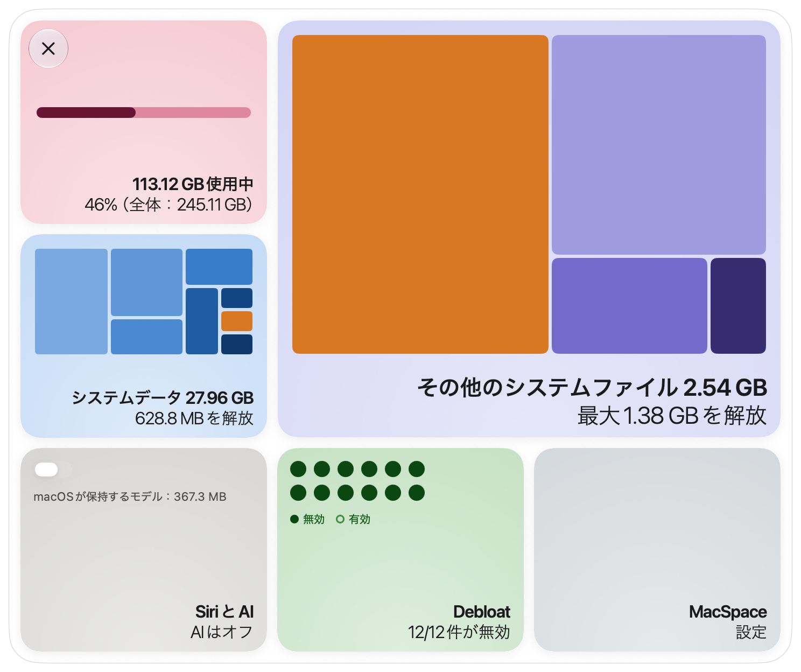
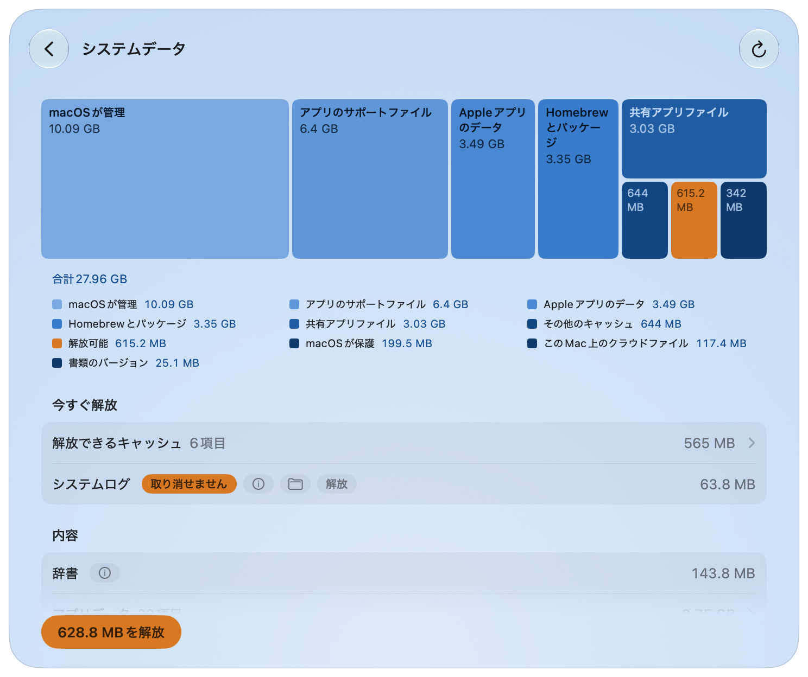
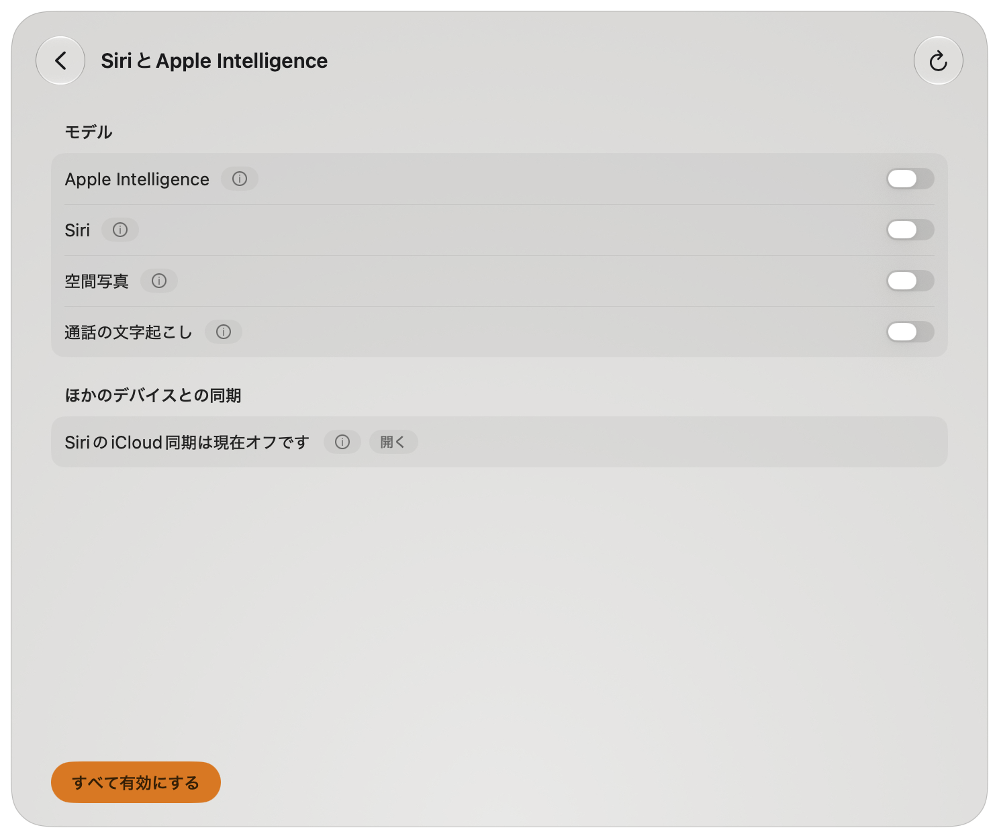
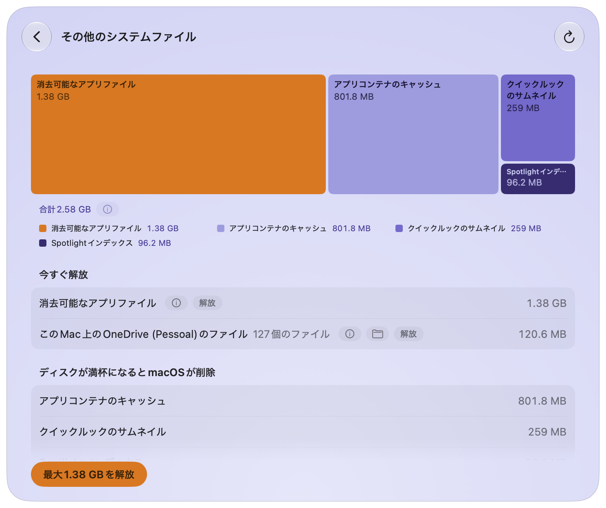
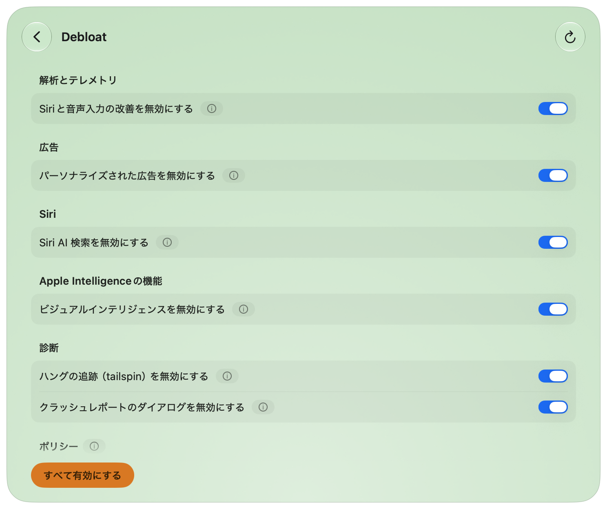
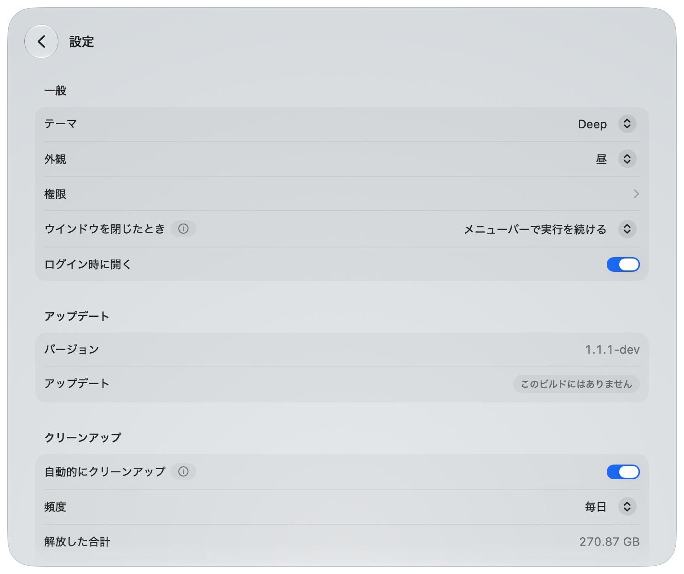
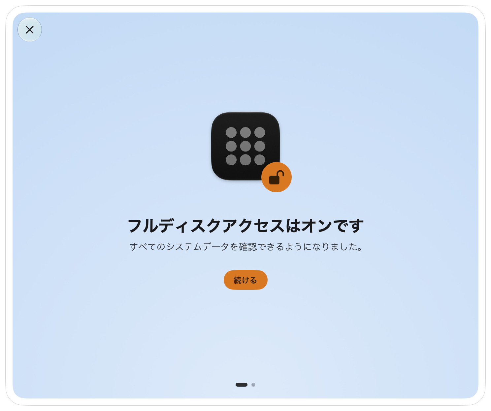

[English](README.md) · [Português](README.pt-BR.md) · [Español](README.es.md) · [Français](README.fr.md) · [Deutsch](README.de.md) · [简体中文](README.zh-Hans.md) · **日本語** · [한국어](README.ko.md)

# MacSpace

**macOS向けの「システムデータ」とApple Intelligenceのクリーナー。**

<p align="center">
<a href="https://trendshift.io/repositories/288700?utm_source=trendshift-badge&amp;utm_medium=badge&amp;utm_campaign=badge-trendshift-288700" target="_blank" rel="noopener noreferrer"></a>
</p>

[](https://github.com/1architect/macspace-releases/actions/workflows/ci.yml)
[](https://github.com/1architect/macspace-releases/releases/latest)
[](LICENSE)


MacSpaceは、システムデータを何が占めているかを示し、安全に削除できるものを解放します。Apple
Intelligenceをオフにし、その後もmacOSがディスクに残すモデルを削除します。Appが消去可能とマークした
ファイルを解放し、macOSで管理できる解析やバックグラウンドでのデータ収集もオフにできます。無料の
オープンソースで、**あなたに関するデータは一切収集しません**。

[**MacSpaceをダウンロード**](#インストール) ·
[プライバシーポリシー](PRIVACY.ja.md) ·
[セキュリティ](SECURITY.ja.md) ·
[変更履歴](CHANGELOG.md)（英語）

<p align="center">
  <picture>
    <source media="(prefers-color-scheme: dark)" srcset="Docs/Screenshots/ja/Home-Dark.png">
    
  </picture>
</p>

---

## 機能

MacSpaceには4つのモジュールがあります。設定でオン／オフを切り替えられます。

**システムデータ。** システムデータは、システム設定が説明しないディスクの部分です。MacSpaceは
システム設定と同じ方法（使用済み容量からmacOSとその他すべてのカテゴリを引いた値）で求めるため、
そこに表示される値に近くなります。そのうえで、キャッシュ、ログ、レポート、システムアセット、
Appのデータ、書類のバージョン履歴に内訳を分けて示します。

メインのボタン**解放**は、安全なものを削除します。より注意が必要な項目には、それぞれ専用のボタンが
あります。macOSや他のAppに属するものについては、それが何であるか、手動で何をすればよいかを
MacSpaceが案内します。Appのキャッシュも選択できます。**解放**は、開いているAppを終了する前に確認します。
また、Appの設定で、MacSpaceの代わりにAppのキャッシュを扱う別のインストール済みクリーナーを選べます。

<p align="center">
  
</p>

**SiriとApple Intelligence。** オフにすると、MacSpaceはSiriをMacとは別の言語に設定します。macOSは
これによってApple Intelligenceが利用できないと判断します。その後MacSpaceは、macOSがディスクに
保持しているモデル（約12 GBになることがあります）を削除します。再びオンにすると、MacSpaceはSiriの
言語と声を元に戻します。

さらに3つのスイッチが、次の機能をオフにして、ディスクに残るモデルを削除します：
**Siri、空間写真、通話の文字起こし**。

<p align="center">
  
</p>

**その他のシステムファイル。** システムデータの外にある、macOSが消去可能として数える容量です。
ディスクがほぼいっぱいになると、macOSがそれを解放します。**最大…を解放**は、macOSにその
クリーンアップを今すぐ実行させます。このMacに保存されているクラウドファイルのコピー
（OneDrive、iCloud Drive、その他のクラウドフォルダ）には、専用の行と**ダウンロードを削除**ボタンが
あります。ファイルはクラウドに残り、開くと再びダウンロードされます。このモジュールは、不要になった
macOSアップデートや古いTime Machineのスナップショットもクリーンアップします。

<p align="center">
  
</p>

**Debloat。** 解析、広告、バックグラウンドでのデータ収集に関する12個のスイッチです。スイッチが
オンのときは、MacSpaceがその機能をオフにしていることを意味します。MacSpaceの実行中は15分ごとに
確認し、macOSが元に戻したものを再びオフにします。

| スイッチ | 内容 | 反映のタイミング |
|---|---|---|
| 解析をAppleと共有 | 使用状況とクラッシュのデータをAppleやApp開発元に送信しなくなります。 | すぐ |
| Siriと音声入力の改善 | Siriと音声入力の録音をAppleと共有しなくなります。 | すぐ |
| Appleのサーバで音声入力と翻訳 | 音声入力と翻訳はこのMac上にとどまります。デバイス上のモデルがない言語は使えなくなります。 | Appを開き直した後 |
| パーソナライズされた広告 | Appleがあなたの行動に基づいて広告を選ばなくなります。 | Appを開き直した後 |
| 広告識別子 | Appが広告識別子であなたを追跡したり、その許可を求めたりできなくなります。 | Appを開き直した後 |
| Siri AI 検索 | Siri AI 検索Appを停止します。Spotlightは従来の検索に戻ります。Siri自体は「SiriとApple Intelligence」のページにあります。 | 再起動後 |
| ビジュアルインテリジェンス | ビジュアルインテリジェンスをオフにします。調べる機能も使えなくなることがあります。 | 再起動後 |
| Spotlightのインターネット検索結果 | Spotlightが検索内容をAppleに送信しなくなります。Spotlightにウェブ検索結果は表示されません。 | Appを開き直した後 |
| ハングの追跡（tailspin） | ハングレポートのために、macOSが常に動作を記録するのを止めます。約100 MBのメモリを解放します。 | すぐ |
| クラッシュレポートのダイアログ | 「予期しない理由で終了しました」のダイアログが表示されなくなります。 | 再起動後 |
| Game Center | Game Centerをオフにします。 | ログアウト後 |
| Apple News | Apple Newsとそのウィジェットを非表示にします。 | ログアウト後 |

このうち5つはポリシーです。無効にするには、システム設定でプロファイルを1回承認する必要があります
（[権限](#初回起動と権限)を参照）。macOSのベータ版では、解析のスイッチもポリシーになります。

<p align="center">
  
</p>

**MacSpaceのその他の機能。** **自動的にクリーンアップ**は、MacSpaceの実行中に、各モジュールが確認なしで
解放できるものを解放します。**最近のクリーンアップ**は、クリーンアップした内容の履歴を表示します。
**ウインドウを閉じたとき**、MacSpaceは終了するか、メニューバーに常駐し続けるか（デフォルト）、
見えない状態でバックグラウンドで動き続けるかを選べます。メニューバーのアイコンを右クリックすると、
各モジュールにすばやくアクセスできます。

---

## インストール

### Homebrew

```bash
brew install --cask 1architect/macspace/macspace
```

### 直接ダウンロード（DMG）

[Releases](https://github.com/1architect/macspace-releases/releases/latest)から最新の
`MacSpace-x.y.z.dmg`をダウンロードして開き、**MacSpace**を「アプリケーション」フォルダにドラッグします。

各リリースには`MacSpace-x.y.z.dmg.sha256`も付属しています。ダウンロードしたファイルを検証するには、
2つのファイルを同じフォルダに置いて次を実行します：

```bash
shasum -a 256 -c MacSpace-x.y.z.dmg.sha256
```

`MacSpace-x.y.z.dmg: OK`と表示されます。MacSpaceはDeveloper IDで署名され、Appleによって公証されています。
詳しくは[セキュリティ](SECURITY.ja.md)をご覧ください。

### 動作環境

macOS 27以降、Apple Silicon。

### アップデートと設定

MacSpaceは[Sparkle](https://sparkle-project.org)でアップデートします。MacSpaceメニューの
**アップデートを確認…**、または**設定 > アップデート**の**今すぐ確認**を選びます。同じ場所の
**アップデートを自動確認**をオンにすると、MacSpaceは実行中におよそ1日1回確認します。すべての
アップデートには署名があり、Sparkleはインストールの前に署名を検証します。

<p align="center">
  
</p>

---

## 初回起動と権限

新規インストールでは、MacSpaceは必要なことを1画面ずつ案内します：**フルディスクアクセスを許可**、
**ヘルパーを承認**、**通知を受け取る**、そして**準備完了**。各ステップは後回しにでき（**後で**）、
すでに完了したステップはスキップされます。**設定 > 権限**からいつでも戻れます。

<p align="center">
  
</p>

| 権限 | 付与する場所 | MacSpaceが必要とする理由 | モジュール |
|---|---|---|---|
| フルディスクアクセス | システム設定 > プライバシーとセキュリティ > フルディスクアクセス | ディスク上のすべてを計測し、Apple Intelligenceの状態を読み取るため。 | システムデータ、SiriとApple Intelligence |
| 特権ヘルパー | システム設定 > 一般 > ログイン項目と機能拡張の**バックグラウンドでの実行を許可**の下 | 管理者権限が必要な少数の処理を行う小さなプログラム（下記参照）。 | システムデータ、SiriとApple Intelligence、Debloat |
| 通知 | 初回にmacOSが確認します | 処理が終わったときや操作が必要なときにお知らせするため。 | すべて |
| 構成プロファイル | システム設定 > 一般 > デバイス管理 | オンにしたDebloatのポリシーを適用します。ポリシーにのみ必要です（5つ。macOSのベータ版では6つ）。 | Debloat |

その他のシステムファイルには、専用の権限は不要です。すべての認証はmacOSが処理するため、MacSpaceが
パスワードを目にすることはありません。

ヘルパーは起動デーモン（launch daemon）`com.macspace.helper`です。内蔵された名前付きの処理だけを実行し、
呼び出し元がコマンドを送ることはできず、MacSpaceと同じ開発チームが署名したクライアントだけを受け付けます。
詳しくは[セキュリティ](SECURITY.ja.md)をご覧ください。

---

## 安全性

**MacSpaceが削除するもの**

- Appが再構築するキャッシュ：ユーザごとのシステムキャッシュフォルダ（`/var/folders/…/C`）内のキャッシュと、
  ChromiumおよびElectronのAppが`~/Library/Application Support`に保存するウェブキャッシュ（`Cache`、
  `Code Cache`、`GPUCache`）。それらを所有するAppまたはツールがヘルパーも含めて終了していて、
  どのプログラムもその中のファイルを開いていない場合に限ります。
- macOSがAppを検証するときに作るコピー（`/var/folders/…/X`）。Appがアップデートされた後にそのコピーだけが
  占めている容量について、かつAppが終了している場合に限ります。
- `/Library/Logs/DiagnosticReports`と`~/Library/Logs/DiagnosticReports`にある、7日より古い診断レポートと
  クラッシュレポート。
- 未使用のシステムアセット、macOSが解放したApple Intelligenceのモデル、Appが消去可能とマークしたファイル。
  MacSpaceは、ディスクがほぼいっぱいのときにmacOSが実行するのと同じ、macOS自身の消去サービスに依頼します。
  必要になれば再びダウンロードされます。
- それぞれ専用のボタンを押したときだけ：書類のバージョン履歴、インストール済みのmacOSアップデートの
  残りファイル、macOSが未完了のまま残した壁紙とスクリーンセーバーのダウンロード、クラウドファイルの
  ローカルコピー。ダウンロードについては、ヘルパーは`/var/folders/…/T/com.apple.idleassetsd`内で3日間
  変更されていない`CFNetworkDownload_*.tmp`ファイルだけを削除するため、進行中のダウンロードは残ります。
- それぞれ専用のボタンを押したときだけ：Apple自身の`log erase`によるシステムログ、macOSがクラッシュレポートを
  読むために保持するシンボル（再構築されます）、ゴミ箱の中身すべて、Time Machineのローカルスナップショット
  （最新のものと、次のバックアップの起点になるものを除く）、接続中のバックアップディスク上で選んだ
  バックアップ（最新のものは残します）。バックアップの実行中は、スナップショットもバックアップも削除されません。
- **Appのキャッシュ**で選んだキャッシュだけ：`~/Library/Caches`内のフォルダと、フルディスクアクセスがある場合は
  各Appのコンテナのキャッシュフォルダの中身（`~/Library/Containers/<app>/Data/Library/Caches`）。ただし、
  macOSがそこに保持しているものを除きます。Appleのキャッシュは対象外です。あらかじめチェックされるものは、
  1か月間変更されておらず、そのAppも同じ期間開かれていないか、インストールされていません。使用中の
  キャッシュはチェックなしで表示され、再び作られることが示されます。開いているAppのキャッシュも
  チェックできます：**解放**はそのAppの名前を示し、終了を依頼し（保存を求められることがあり、キャンセルも
  できます）、そのキャッシュを解放します。自動クリーンアップがAppを終了することはありません。メディアや、
  ユーザが名前を付けた書類を含むフォルダは表示されません。
- **Homebrew**の行からだけ：Homebrew自身の`brew cleanup`を、あなたとして実行します。formulaの削除、
  アップデート、Homebrewの解析データの送信は行いません。

**触れないもの。** MacSpaceは、書類、写真、メール、メッセージが占める容量を計測するだけです。未完了の
ダウンロード、macOSのリストアイメージ、仮想マシンなどの大きな項目を一覧表示します。他のAppのデータには
手を触れず、そのApp内でのクリーンアップ方法を案内します。**個人のファイルを読み取ったり削除したりしません。
システム整合性保護をオフにしたり、封印されたシステムボリュームを変更したりしません。**

**使用中の権限。** 複数のAppのキャッシュを削除するボタンは、すべて確認を求めます。書類のバージョン履歴、
システムログ、ゴミ箱、Time Machineのスナップショットとバックアップの**解放**には**取り消せません**の
バッジが付きます。**Apple Intelligence**のスイッチと個々のDebloatのスイッチはすぐに反映され、変更に失敗した
場合は自動的に元に戻ります。

**元に戻せる操作。** Debloat：機能を再びオンにするか、**すべて有効にする**を押します。MacSpaceは、
変更前に保存した設定を復元します。Apple IntelligenceとSiri関連のオプション：再びオンにします。
MacSpaceはSiriの言語と声を復元し、macOSはモデルを再びダウンロードすることがあります。削除した
キャッシュは再構築されます。削除したレポート、バージョン履歴、ログ、ゴミ箱の項目、スナップショット、
バックアップは元に戻りません。

---

## プライバシー

MacSpaceには、解析も、テレメトリも、クラッシュレポートも、アカウントもありません。計測した内容、
クリーンアップの履歴、設定は、Macの`~/Library/Application Support/MacSpace/`に保存されます。ネットワークは
アップデートという1つの目的にだけ使います。MacSpaceはGitHub上の小さなアップデートフィードを読み、
アップデートを承諾した場合にGitHubからダウンロードします。システムのプロファイルも識別子も送信しません。
書き込むすべてのファイルと、読み取るすべての内容は、[プライバシーポリシー](PRIVACY.ja.md)と
[セキュリティポリシー](SECURITY.ja.md)に記載されています。

---

## アンインストール

**アンインストール**するには、MacSpaceのアンインストーラを使います。メニューバーで**MacSpace**を押し、
**MacSpaceについて**を選んで、**アンインストール**をクリックします。アンインストーラは以下の手順を自動で
行います。

手動で行う場合は、次の順序に従ってください：

1. **MacSpaceが変更した内容を元に戻します。** **Debloat**で**すべて有効にする**を押します。これにより、
   MacSpace自身のフォルダの外にDebloatが書き込んだ上書き設定も削除されます（Appを削除するだけでは
   残ります）。再起動が必要な場合は、ページにその旨が表示されます。Apple Intelligence、Siri、空間写真、
   通話の文字起こしをオフにしていて元に戻したい場合は、**SiriとApple Intelligence**でオンにします。
2. **プロファイルを削除します**（まだインストールされている場合）：システム設定 > 一般 > デバイス管理で
   **MacSpace: policies**（識別子`com.macspace.policies`）を選んで削除します。
3. **MacSpaceを終了します**（MacSpaceメニューの**MacSpaceを終了**、またはメニューバーアイコンのメニューから）。
   ヘルパーを削除します：システム設定 > 一般 > ログイン項目と機能拡張でMacSpaceをオフにするか、Appを
   削除する前に次を実行します：
   ```bash
   /Applications/MacSpace.app/Contents/MacOS/MacSpaceCli helper --unregister
   ```
4. **Appを削除します：** `brew uninstall --cask macspace`（`--zap`を付けるとデータと設定も削除されます）、
   または「アプリケーション」から**MacSpace**をゴミ箱にドラッグします。
5. **データと設定を削除します：**
   ```bash
   rm -rf ~/Library/Application\ Support/MacSpace ~/Library/Logs/MacSpace ~/Library/Caches/com.macspace.app
   defaults delete com.macspace.app
   sudo rm -rf /Library/Application\ Support/MacSpace
   ```
   最後の行は、Debloatや通話の文字起こしを使った場合、または残っていたApple Intelligenceの
   サブスクリプションを削除した場合にのみ必要です。手順1の後に実行してください。このフォルダには、
   MacSpaceが復元する元の設定が入っています。
6. **フルディスクアクセスを削除します：** システム設定 > プライバシーとセキュリティ > フルディスクアクセスで
   MacSpaceを選び、マイナスボタンを押します。

---

## ソースからビルド

ソースはこのリポジトリです。macOS 27とXcode 27が必要です。

```bash
export DEVELOPER_DIR=/Applications/Xcode-beta.app/Contents/Developer
swift test
INSTALL=1 Scripts/Assemble.sh
```

最後のコマンドは`Build/MacSpace.app`をビルドして`/Applications`にコピーします。Developer ID証明書が
ない場合、ビルドはアドホック署名となり公証されず、ビルドのたびにmacOSがフルディスクアクセスを再び
求めます。自分でビルドしたものにはアップデート用の鍵がないため、アップデートの確認は行いません。

---

## サポートと貢献

**dev@giomantovani.com.br**

バグ、アイデア、誤った翻訳：[GitHub Issues](https://github.com/1architect/macspace-releases/issues)。
セキュリティ上の問題：公開のissueには絶対に書かず、[SECURITY.ja.md](SECURITY.ja.md)をご覧ください。
貢献するには[CONTRIBUTING.md](CONTRIBUTING.md)（英語）をお読みください。参加するすべての人は
[行動規範](CODE_OF_CONDUCT.md)（英語）に従います。変更は[変更履歴](CHANGELOG.md)に記載されます。

---

## ライセンス

MacSpaceはMITライセンスの自由なソフトウェアです。Copyright (c) 2026 1architect。[LICENSE](LICENSE)
（英語）をご覧ください。法的拘束力があるのは英語の文面です。`LICENSE.<language>.md`の翻訳は便宜上の
ものです。サードパーティの通知は[NOTICE](NOTICE)（英語）にあります。

MacSpaceはAppleとは提携していません。Apple Intelligence、Siri、macOSはApple Inc.の商標です。
