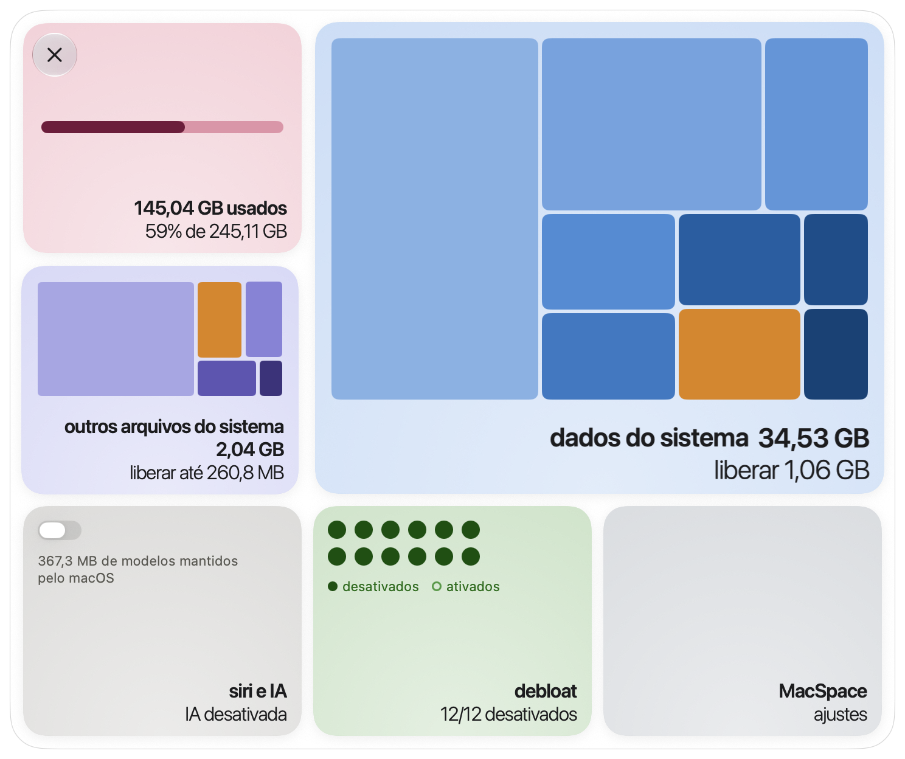
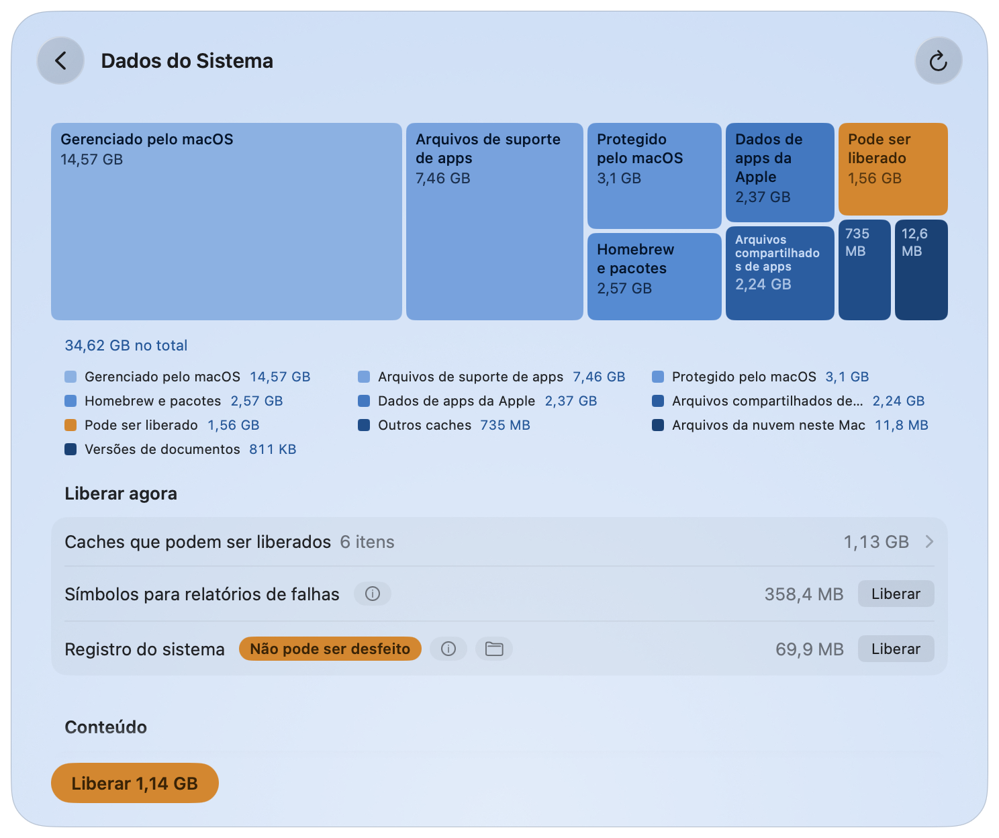
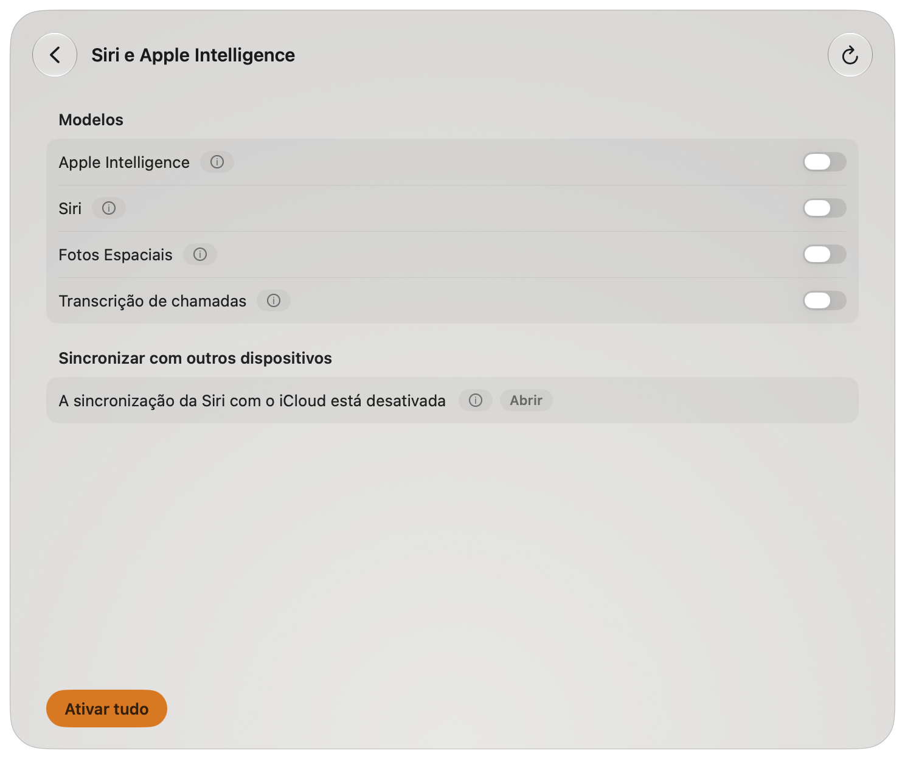
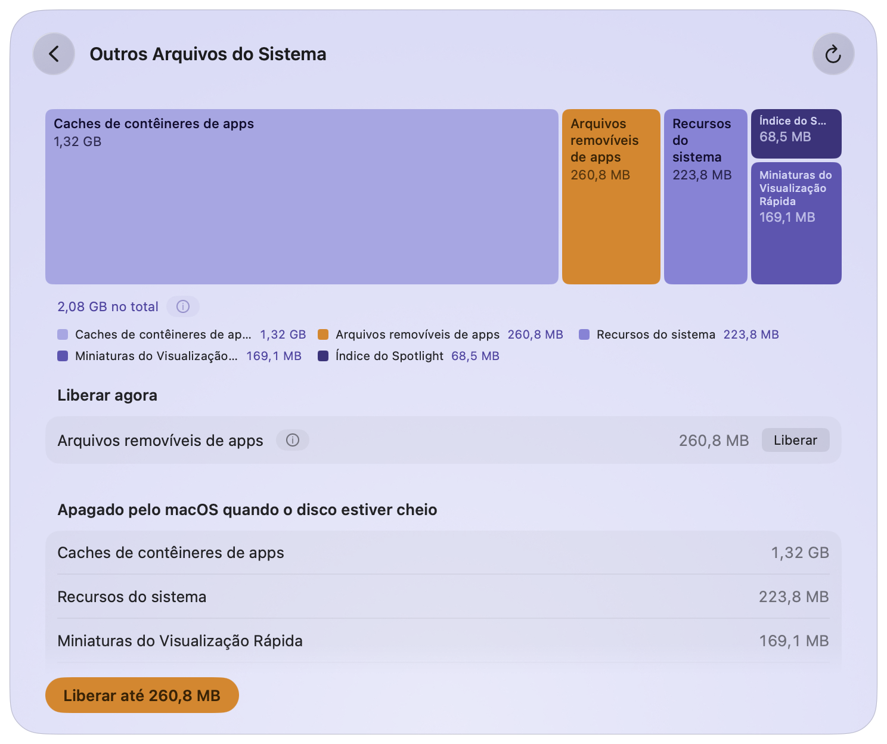
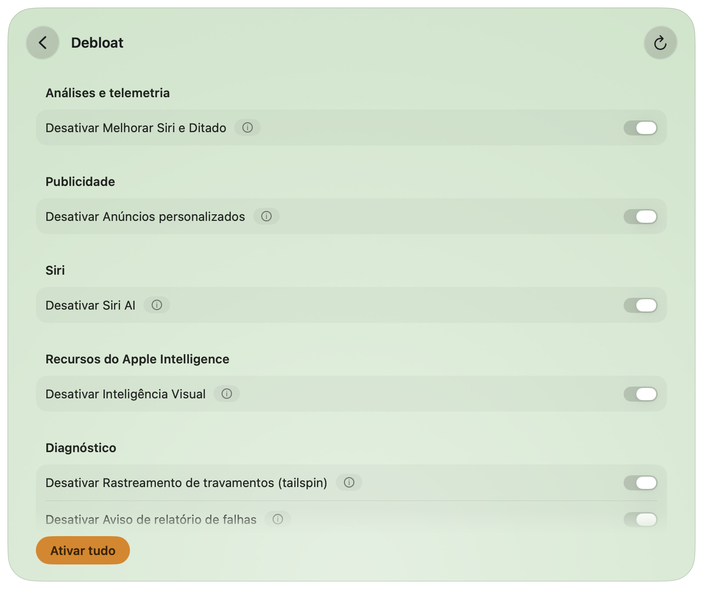
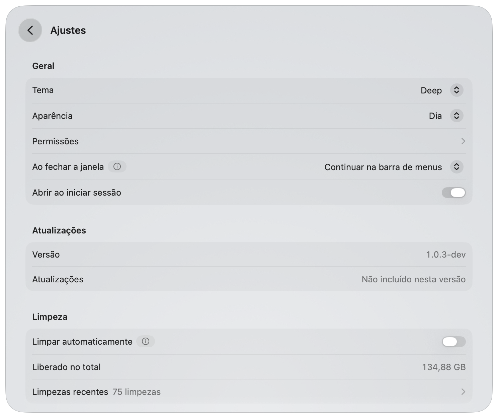
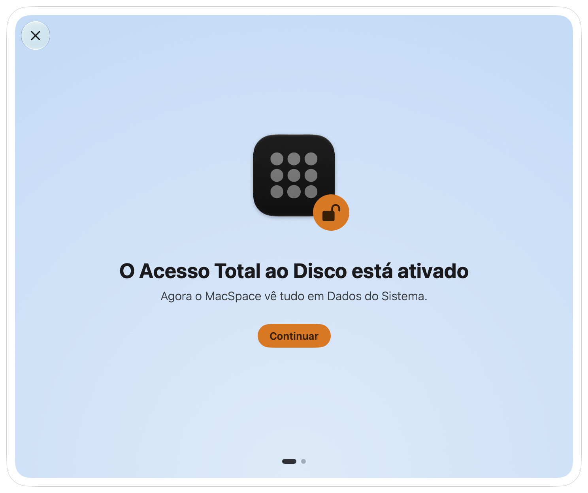

[English](README.md) · **Português** · [Español](README.es.md) · [Français](README.fr.md) · [Deutsch](README.de.md) · [简体中文](README.zh-Hans.md) · [日本語](README.ja.md) · [한국어](README.ko.md)

# MacSpace

**Um limpador de Dados do Sistema e do Apple Intelligence para o macOS.**

<p align="center">
<a href="https://trendshift.io/repositories/288700?utm_source=trendshift-badge&amp;utm_medium=badge&amp;utm_campaign=badge-trendshift-288700" target="_blank" rel="noopener noreferrer"></a>
</p>

[](https://github.com/1architect/macspace-releases/actions/workflows/ci.yml)
[](https://github.com/1architect/macspace-releases/releases/latest)
[](LICENSE)


O MacSpace mostra o que ocupa Dados do Sistema e libera o que pode ser apagado com segurança. Ele
desativa o Apple Intelligence e apaga os modelos que o macOS mantém no disco depois disso. Libera
os arquivos que os apps marcaram como removíveis e pode desativar as análises e a coleta de dados
em segundo plano que o macOS permite controlar. É gratuito, de código aberto e **não coleta
nenhum dado sobre você**.

[**Baixar o MacSpace**](#instalar) ·
[Política de Privacidade](PRIVACY.pt-BR.md) ·
[Segurança](SECURITY.pt-BR.md) ·
[Histórico de alterações](CHANGELOG.md) (em inglês)

<p align="center">
  <picture>
    <source media="(prefers-color-scheme: dark)" srcset="Docs/Screenshots/pt-BR/Home-Dark.png">
    
  </picture>
</p>

---

## O que o MacSpace faz

O MacSpace tem quatro módulos. Você pode ativá-los ou desativá-los nos Ajustes.

**Dados do Sistema.** Dados do Sistema é a parte do disco que os Ajustes do Sistema não explicam.
O MacSpace faz a conta do mesmo jeito que os Ajustes do Sistema (espaço usado, menos o macOS e
todas as outras categorias), então o valor fica perto do que você vê lá. Depois ele detalha:
caches, registros, relatórios, recursos do sistema, dados de apps, histórico de versões de
documentos.

O botão principal, **Liberar**, apaga o que é seguro. Os itens que pedem mais cuidado têm botões
próprios. Para tudo o que pertence ao macOS ou a outros apps, o MacSpace diz o que é e o que fazer
à mão. Os caches de apps também podem ser escolhidos: **Liberar** pergunta antes de encerrar um app
aberto. Ou, nos ajustes do app, escolha outro limpador instalado para cuidar dos caches de apps no
lugar do MacSpace.

<p align="center">
  
</p>

**Siri e Apple Intelligence.** Desativado, o MacSpace define a Siri para um idioma diferente do do
seu Mac. É assim que o macOS decide que o Apple Intelligence não está disponível. Depois o MacSpace
apaga os modelos que o macOS mantém no disco, o que pode chegar a cerca de 12 GB. Ative-o de novo e
o MacSpace devolve o idioma e a voz da sua Siri.

Mais três interruptores desativam os recursos a seguir e apagam os modelos que ficam no disco:
**Siri, Fotos Espaciais e Transcrição de chamadas**.

<p align="center">
  
</p>

**Outros Arquivos do Sistema.** Espaço fora de Dados do Sistema que o macOS conta como removível.
O macOS o libera quando o disco está quase cheio. **Liberar até** faz o macOS fazer essa limpeza
agora. As cópias de arquivos da nuvem guardadas neste Mac (OneDrive, iCloud Drive e outras pastas
da nuvem) têm uma linha e um botão próprios, **Remover Downloads**. Os arquivos continuam na nuvem
e são baixados de novo quando você os abre. Este módulo também limpa atualizações antigas do macOS
e instantâneos antigos do Time Machine.

<p align="center">
  
</p>

**Debloat.** Doze interruptores para análises, publicidade e coleta de dados em segundo plano. Se o
interruptor está ativado, significa que o MacSpace desativou esse recurso. Enquanto o MacSpace está
aberto, ele verifica a cada 15 minutos e desativa de novo tudo o que o macOS reativou.

| Interruptor | O que faz | Vale depois de |
|---|---|---|
| Compartilhar análises com a Apple | Deixa de enviar dados de uso e de falhas para a Apple e os desenvolvedores. | Nada |
| Melhorar Siri e Ditado | Deixa de compartilhar gravações da Siri e do Ditado com a Apple. | Nada |
| Ditado e tradução nos servidores da Apple | Ditado e tradução ficam neste Mac. Idiomas sem modelo no aparelho deixam de funcionar. | Reabrir os apps |
| Anúncios personalizados | A Apple deixa de escolher anúncios com base no que você faz. | Reabrir os apps |
| Identificador de publicidade | Os apps não podem rastrear você com o identificador de publicidade nem pedi-lo. | Reabrir os apps |
| Busca da Siri AI | Encerra o app de busca da Siri AI. O Spotlight volta à busca clássica. A Siri em si fica na página Siri e Apple Intelligence. | Reiniciar |
| Inteligência Visual | Desativa a Inteligência Visual. A Consulta Visual também pode deixar de funcionar. | Reiniciar |
| Resultados da internet no Spotlight | O Spotlight deixa de enviar suas buscas à Apple. Sem resultados da web no Spotlight. | Reabrir os apps |
| Rastreamento de travamentos (tailspin) | Impede que o macOS grave atividade o tempo todo para relatórios de travamento. Libera cerca de 100 MB de memória. | Nada |
| Aviso de relatório de falhas | Chega de avisos de “encerrado inesperadamente”. | Reiniciar |
| Game Center | Desativa o Game Center. | Encerrar a sessão |
| Apple News | Oculta o Apple News e seus widgets. | Encerrar a sessão |

Cinco deles são políticas. Desativar uma pede que você aprove um perfil nos Ajustes do Sistema uma
vez (veja [Permissões](#primeira-abertura-e-permissões)). No macOS beta, o interruptor de análises
também é uma política.

<p align="center">
  
</p>

**Também no MacSpace.** **Limpar automaticamente** libera, sem perguntar, o que os módulos podem
liberar, enquanto o MacSpace está aberto. **Limpezas recentes** mostra o histórico do que foi
limpo. **Ao fechar a janela**, o MacSpace pode encerrar, continuar na barra de menus (o padrão) ou
continuar em segundo plano sem aparecer. Clique com o botão direito no ícone da barra de menus para
acessar facilmente cada módulo.

---

## Instalar

### Homebrew

```bash
brew install --cask 1architect/macspace/macspace
```

### Download direto (DMG)

Baixe o `MacSpace-x.y.z.dmg` mais recente em
[Releases](https://github.com/1architect/macspace-releases/releases/latest), abra-o e arraste o
**MacSpace** para a pasta Aplicativos.

Cada versão também tem um `MacSpace-x.y.z.dmg.sha256`. Para conferir o seu download, coloque os dois
arquivos na mesma pasta e execute:

```bash
shasum -a 256 -c MacSpace-x.y.z.dmg.sha256
```

Ele imprime `MacSpace-x.y.z.dmg: OK`. O MacSpace é assinado com um Developer ID e notarizado pela
Apple. Veja [Segurança](SECURITY.pt-BR.md) para saber mais.

### Requisitos

macOS 27 ou posterior, em Apple Silicon.

### Atualizações e ajustes

O MacSpace se atualiza com o [Sparkle](https://sparkle-project.org). Escolha **Buscar
Atualizações…** no menu MacSpace ou **Verificar Agora** em **Ajustes > Atualizações**.
**Buscar atualizações automaticamente**, no mesmo lugar, faz o MacSpace procurar cerca de uma vez
por dia enquanto está aberto. Toda atualização é assinada, e o Sparkle confere a assinatura antes
de instalar qualquer coisa.

<p align="center">
  
</p>

---

## Primeira abertura e permissões

Numa instalação nova, o MacSpace começa pelo que precisa, uma tela por vez: **Permitir Acesso Total
ao Disco**, **Aprove o auxiliar**, **Receba notificações** e, por fim, **Tudo pronto**. Cada etapa
pode esperar (**Mais tarde**), e as etapas que você já fez são puladas. Você pode voltar a elas em
**Ajustes > Permissões**.

<p align="center">
  
</p>

| Permissão | Onde concedê-la | Por que o MacSpace precisa | Módulos |
|---|---|---|---|
| Acesso Total ao Disco | Ajustes do Sistema > Privacidade e Segurança > Acesso Total ao Disco | Para medir tudo no disco e ler o estado do Apple Intelligence. | Dados do Sistema, Siri e Apple Intelligence |
| Auxiliar privilegiado | Ajustes do Sistema > Geral > Itens de Início e Extensões, em **Permitir em Segundo Plano** | Um pequeno programa que faz as poucas tarefas que exigem um administrador (veja abaixo). | Dados do Sistema, Siri e Apple Intelligence, Debloat |
| Notificações | O macOS pergunta na primeira vez | Para avisar você quando algo terminou ou precisa de você. | Todos |
| Perfil de configuração | Ajustes do Sistema > Geral > Gerenciamento de Dispositivo | Aplica as políticas do Debloat que você ativar. Necessário apenas para as políticas (cinco; seis no macOS beta). | Debloat |

Outros Arquivos do Sistema não precisa de permissão própria. O macOS cuida de toda autorização,
então o MacSpace nunca vê a sua senha.

O auxiliar é um daemon de inicialização (launch daemon), `com.macspace.helper`. Ele só executa
operações nomeadas que estão embutidas nele, quem o chama não consegue enviar comandos a ele, e ele
só aceita clientes assinados pela mesma equipe de desenvolvimento do MacSpace. Veja
[Segurança](SECURITY.pt-BR.md) para saber mais.

---

## Uso seguro

**Itens que o MacSpace apaga**

- Caches que os apps recriam: os caches da pasta de cache do sistema de cada usuário
  (`/var/folders/…/C`) e os caches da web (`Cache`, `Code Cache`, `GPUCache`) que os apps Chromium
  e Electron guardam em `~/Library/Application Support`. Somente enquanto o app ou a ferramenta dona
  deles está fechada, com seus processos auxiliares, e nenhum programa tem um arquivo aberto neles.
- As cópias que o macOS faz de um app ao verificá-lo (`/var/folders/…/X`), pelo espaço que elas
  ocupam sozinhas depois que o app foi atualizado, e só enquanto o app está fechado.
- Relatórios de diagnóstico e de falhas com mais de 7 dias, em `/Library/Logs/DiagnosticReports` e
  `~/Library/Logs/DiagnosticReports`.
- Recursos do sistema sem uso, modelos do Apple Intelligence que o macOS liberou e arquivos que os
  apps marcaram como removíveis. O MacSpace pede isso ao serviço de limpeza do próprio macOS, o
  mesmo que o macOS executa quando o disco está quase cheio. Eles são baixados de novo se forem
  necessários.
- Somente quando você clica no botão próprio: o histórico de versões de documentos, os arquivos
  restantes de uma atualização do macOS já instalada, os downloads de fundos de tela e protetores
  de tela que o macOS deixou incompletos e as cópias locais de arquivos da nuvem. Nos downloads, o
  auxiliar apaga só os arquivos `CFNetworkDownload_*.tmp` de `/var/folders/…/T/com.apple.idleassetsd`
  que não mudam há 3 dias, então um download em andamento continua.
- Somente quando você clica no botão próprio: o registro do sistema, com o `log erase` da própria
  Apple; os símbolos que o macOS guarda para ler relatórios de falhas, que ele recria; tudo o que
  está no Lixo; os instantâneos locais do Time Machine, menos o mais recente e o que o próximo
  backup usa como ponto de partida; e os backups que você escolher num disco de backup conectado,
  nunca o mais recente. Instantâneos e backups nunca são apagados durante um backup.
- Somente os caches que você escolhe em **Caches de apps**: pastas de `~/Library/Caches` e, com
  Acesso Total ao Disco, o que está na pasta de caches do contêiner de cada app
  (`~/Library/Containers/<app>/Data/Library/Caches`), exceto o que o macOS guarda lá. Nunca os da
  Apple. As que já vêm marcadas não mudam há um mês, e o app delas não é aberto há tanto tempo ou
  não está instalado. Caches em uso aparecem desmarcados e avisam que voltam. Os caches de um app
  aberto também podem ser marcados: **Liberar** diz o nome do app, pede que ele encerre (ele pode
  pedir que você salve, e você pode cancelar) e então libera o cache dele. A limpeza automática
  nunca encerra um app. Pastas com mídias ou documentos com nomes dados por pessoas não são
  oferecidas.
- Somente pela linha **Homebrew**: o `brew cleanup` do próprio Homebrew, rodado como você, sem
  desinstalar fórmulas, atualizar ou enviar as estatísticas do Homebrew.

**Itens que ele não toca.** O MacSpace só mede quanto espaço ocupam os seus documentos, o Fotos, o
Mail e o Mensagens. Ele lista itens grandes, como downloads incompletos, imagens de restauração do
macOS e máquinas virtuais. Ele não mexe nos dados de outros apps e diz como limpá-los de dentro do
próprio app. **Ele não lê nem apaga os seus arquivos pessoais. Ele não desativa a Proteção de
Integridade do Sistema e não altera o volume do sistema selado.**

**Permissões durante o uso.** Todo botão que apaga os caches de mais de um app pede confirmação.
**Liberar** no histórico de versões de documentos, no registro do sistema, no Lixo e nos
instantâneos e backups do Time Machine traz o selo **Não pode ser desfeito**. O interruptor **Apple
Intelligence** e cada interruptor do Debloat agem na hora e voltam sozinhos ao estado anterior se a
alteração falhar.

**Ações reversíveis.** Debloat: ative o recurso de novo ou clique em **Ativar tudo**. O MacSpace
restaura os ajustes que salvou antes de alterá-los. Apple Intelligence e as opções ligadas à Siri:
ative-as de novo. O MacSpace restaura o idioma e a voz da sua Siri, e o macOS pode baixar os
modelos de novo. Os caches apagados são recriados. Relatórios, histórico de versões, registros,
itens do Lixo, instantâneos e backups apagados não voltam.

---

## Privacidade

O MacSpace não tem análises de uso, telemetria, relatório de falhas nem conta. O que ele mede, o
seu histórico de limpezas e os seus ajustes ficam no seu Mac, em
`~/Library/Application Support/MacSpace/`. A rede é usada para uma única coisa: atualizações. O
MacSpace lê um pequeno feed de atualizações no GitHub e, se você aceitar uma atualização, a baixa
do GitHub. Ele não envia perfil de sistema nem identificador. Cada arquivo que ele grava, e tudo o
que ele lê, está na [Política de Privacidade](PRIVACY.pt-BR.md) e na
[Política de Segurança](SECURITY.pt-BR.md).

---

## Desinstalar

Para **desinstalar**, use o desinstalador do MacSpace. Na barra de menus, clique em **MacSpace**,
depois em **Sobre o MacSpace** e então em **Desinstalar**. O desinstalador automatiza o processo
abaixo.

Se preferir fazer isso manualmente, siga a ordem abaixo:

1. **Desfaça o que o MacSpace alterou.** Em **Debloat**, clique em **Ativar tudo**. Isso também
   remove as substituições que o Debloat gravou fora das pastas do próprio MacSpace, que continuam
   no lugar se você apenas apagar o app. Se for preciso reiniciar, a página avisa. Se você
   desativou o Apple Intelligence, a Siri, as Fotos Espaciais ou a Transcrição de chamadas e quer
   tê-los de volta, ative-os em **Siri e Apple Intelligence**.
2. **Remova o perfil**, se ainda houver um instalado: em Ajustes do Sistema > Geral > Gerenciamento
   de Dispositivo, selecione **MacSpace: policies** (identificador `com.macspace.policies`) e
   remova-o.
3. **Encerre o MacSpace** (**Encerrar o MacSpace** no menu MacSpace ou no menu do ícone dele na
   barra de menus). Remova o auxiliar: desative o MacSpace em Ajustes do Sistema > Geral > Itens de
   Início e Extensões ou execute isto antes de apagar o app:
   ```bash
   /Applications/MacSpace.app/Contents/MacOS/MacSpaceCli helper --unregister
   ```
4. **Remova o app:** `brew uninstall --cask macspace` (acrescente `--zap` para remover também os
   dados e as preferências dele) ou arraste o **MacSpace** de Aplicativos para o Lixo.
5. **Remova os dados e as preferências:**
   ```bash
   rm -rf ~/Library/Application\ Support/MacSpace ~/Library/Logs/MacSpace ~/Library/Caches/com.macspace.app
   defaults delete com.macspace.app
   sudo rm -rf /Library/Application\ Support/MacSpace
   ```
   A última linha só é necessária se você usou o Debloat ou a Transcrição de chamadas, ou removeu
   assinaturas restantes do Apple Intelligence. Execute-a depois da etapa 1: essa pasta guarda os
   originais que o MacSpace restaura.
6. **Remova o Acesso Total ao Disco:** em Ajustes do Sistema > Privacidade e Segurança > Acesso
   Total ao Disco, selecione o MacSpace e clique no botão de menos.

---

## Compilar a partir do código-fonte

O código-fonte é este repositório. Você precisa do macOS 27 e do Xcode 27.

```bash
export DEVELOPER_DIR=/Applications/Xcode-beta.app/Contents/Developer
swift test
INSTALL=1 Scripts/Assemble.sh
```

O último comando compila `Build/MacSpace.app` e o copia para `/Applications`. Sem um certificado
Developer ID, a compilação é assinada ad hoc e não é notarizada, e o macOS pede o Acesso Total ao
Disco de novo a cada compilação. Uma versão que você mesmo compila não tem chave de atualização,
então nunca busca atualizações.

---

## Suporte e contribuição

**dev@giomantovani.com.br**

Bugs, ideias e traduções erradas: [GitHub Issues](https://github.com/1architect/macspace-releases/issues).
Problemas de segurança: nunca em uma issue pública, veja [SECURITY.pt-BR.md](SECURITY.pt-BR.md).
Para contribuir, leia o [CONTRIBUTING.md](CONTRIBUTING.md) (em inglês). Todas as pessoas que
participam seguem o [Código de Conduta](CODE_OF_CONDUCT.md) (em inglês). As alterações estão
listadas no [Histórico de alterações](CHANGELOG.md).

---

## Licença

O MacSpace é software livre sob a licença MIT. Copyright (c) 2026 1architect. Veja o
[LICENSE](LICENSE) (em inglês). O texto em inglês é o que tem validade jurídica. As traduções em
`LICENSE.<idioma>.md` são só de cortesia. Os avisos de terceiros estão no [NOTICE](NOTICE) (em
inglês).

O MacSpace não é afiliado à Apple. Apple Intelligence, Siri e macOS são marcas comerciais da Apple
Inc.
